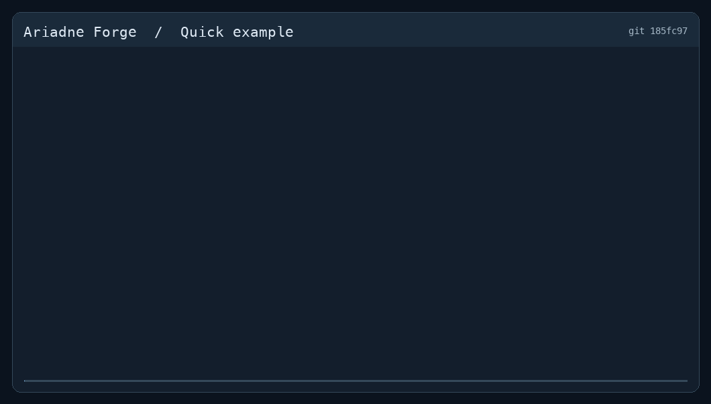
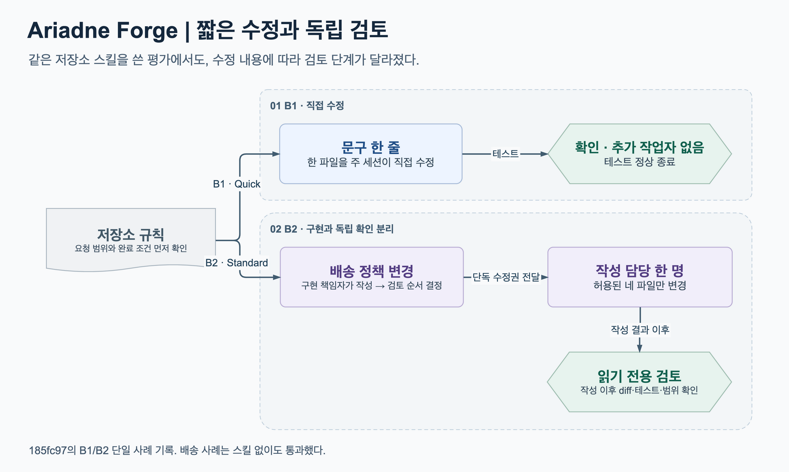
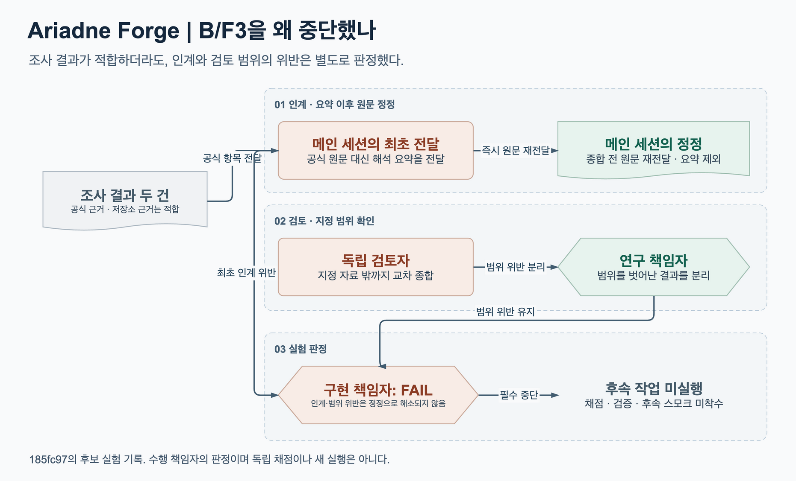
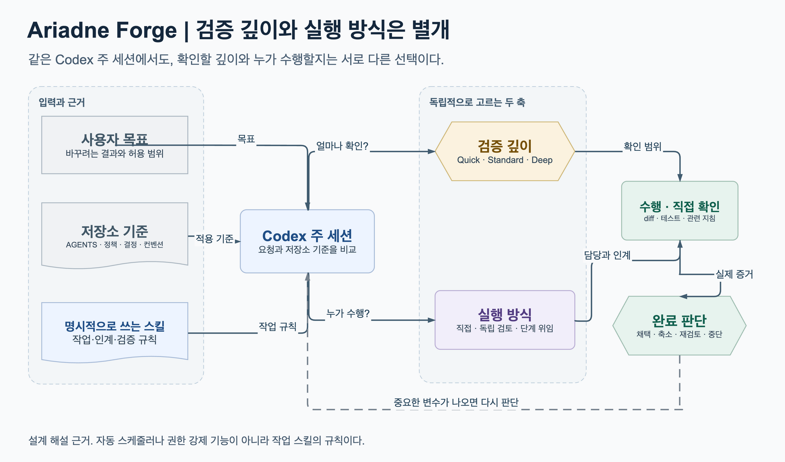
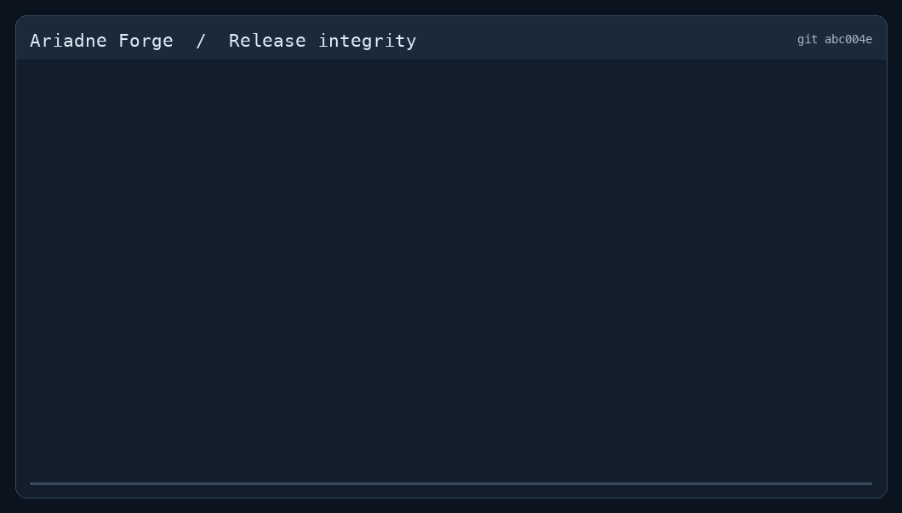
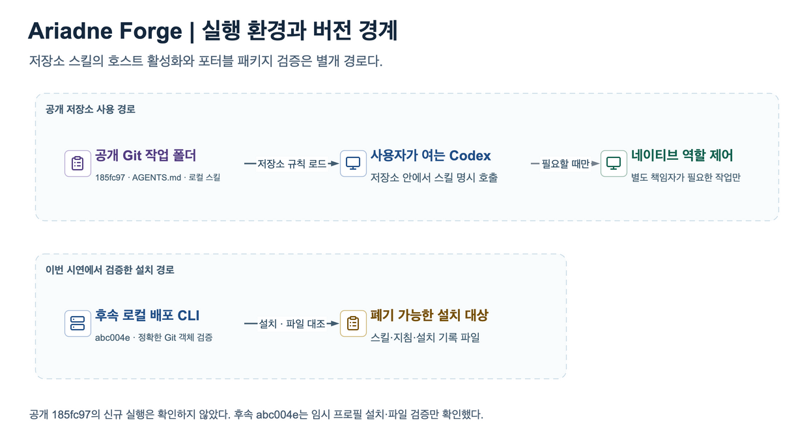

# Ariadne Forge

**작업의 크기에 맞춰 조사·구현·검증 범위를 정하는 Codex 스킬입니다.**

한 파일 수정은 직접 확인하고, 조사 결과가 구현을 바꿀 수 있거나 독립 검토가 필요한 작업에만 역할을 나눕니다. 에이전트 수를 늘리는 대신 **누가 판단하고 무엇을 보고 다음 단계로 넘어갈지** 정하는 데 초점을 맞췄습니다.

| 프로젝트 정보 | 내용 |
| --- | --- |
| 형태 | Codex 저장소 로컬 스킬과 평가 시나리오. 별도의 작업 서버나 오케스트레이션 엔진은 없습니다. |
| 기준 버전 | [공개 저장소 로컬 스킬 `185fc97`](https://github.com/SungKong00/ariadne-forge/blob/185fc97c4400d0158090f5d182a6b0e3f5d1ac2a/.agents/skills/ariadne-workflow/SKILL.md) |
| 실행 환경 | Codex와 Git으로 저장소 내 스킬 실행, 릴리스 확인은 Python CLI |
| 담당 범위 | Quick / Standard / Deep 분류, 책임과 전달 기준, 근거를 확인하는 완료 규칙, 비교 평가 시나리오 설계. |

## 어떤 문제를 풀었나

“구현했다”는 응답과 실제 변경·테스트는 같지 않습니다. 반대로 한 줄 고치면서 조사, 위임, 별도 검토를 모두 시작하면 검증보다 진행 절차가 더 비싸질 수 있습니다. 이 스킬은 **작은 일은 작게 끝내고**, 책임을 나눠야 할 때만 전달·검증 조건을 세웁니다.

## 요청 종류에 따라 달라지는 작업 흐름

| 경로 | 언제 사용하는가 | 책임과 결과 |
| --- | --- | --- |
| Quick · 직접 수정 | 수정 범위와 확인 방법이 분명한 일 | 본 세션이 한 번에 수정하고 테스트 결과를 남깁니다. |
| Standard · 구현과 검증 분리 | 여러 규칙이 얽혀 독립 확인이 필요한 일 | 구현 책임자가 단일 쓰기 담당과 읽기 전용 검증을 순서대로 엽니다. |
| Deep · 근거 확인 후 방향 결정 | 조사에 따라 요구사항이나 설계가 바뀌는 일 | 조사 책임자가 원문과 반례를 정리하고, 본 세션이 채택 여부와 후속 구현을 결정합니다. |
| 릴리스 · 스킬 설치 검증 | 새 버전을 Codex에서 쓰기 전에 확인할 때 | 배포 CLI가 Git 버전과 실제 설치 파일을 대조합니다. |

완료 확인은 별도의 역할을 늘리는 경로가 아닙니다. 어느 경로든 요약보다 실제 변경분과 테스트 결과를 우선해, 확인 결과에 맞춰 완료 여부를 정합니다.

### Quick · 인사말 하나를 바꾸고 직접 확인

별도 조사나 위임 없이 인사말 파일을 수정합니다. 기존 테스트를 실행해 종료 코드 0을 확인하고, Git으로 실제 변경이 한 파일인지 확인합니다. 영상은 공개 평가 예제에서 같은 변경과 테스트를 직접 실행한 결과입니다. 당시 Codex 동작은 [Quick 평가 기록](https://github.com/SungKong00/ariadne-forge/blob/185fc97c4400d0158090f5d182a6b0e3f5d1ac2a/evals/ariadne-workflow/runs/with-skill-001/report.md)에서 확인할 수 있습니다.

[같은 예제 실행하기](docs/portfolio-readme/docs/quickstart.md) · [명령 출력](docs/portfolio-readme/docs/quick-transcript.txt)

### Standard · 배송료 계산을 수정하고 독립 검토

배송비 정책, 계산 로직, 요약 표시가 함께 바뀌는 예제입니다. 구현 책임자가 변경 담당 한 명에게 쓰기 범위를 맡기고, 변경 결과를 채택한 뒤 별도의 읽기 전용 검증자가 테스트·변경 범위·산출물을 확인했습니다.

[Quick·Standard 비교 기록](docs/portfolio-readme/docs/workflow.md) · [편집용 draw.io](docs/portfolio-readme/assets/routing.drawio)

### Deep · 조사 결과를 바탕으로 App Server 도입 판단

Codex App Server가 필요한지 공식 자료와 저장소에서 조사하고, 반례가 있는지 검토했습니다. 요약을 먼저 넘기자 검토자가 원문과 판단을 분리하기 어려웠고 일부 검토는 배정 범위를 벗어났습니다. 자료와 판단 경계를 다시 확인하는 선에서 마무리하고, 후속 구현은 시작하지 않았습니다. 조사 결론과 구현 착수를 별개로 다루는 사례입니다.

[당시 실행 기록](https://github.com/SungKong00/ariadne-forge/blob/185fc97c4400d0158090f5d182a6b0e3f5d1ac2a/evals/ariadne-workflow/experiments/0003-reference-research-team-embedded-method/run-record.md#L239-L350) · [편집용 draw.io](docs/portfolio-readme/assets/handoff.drawio)

## 시스템 구조

저장소 로컬 스킬과 작업 규칙이 판단 기준을 제공합니다. Codex가 역할을 조정하고, 변경 산출물과 직접 확인한 근거를 대조합니다. 스킬 자체가 권한이나 단계 전환을 강제하는 런타임은 아닙니다.

[편집용 draw.io](docs/portfolio-readme/assets/system.drawio) · [SVG](docs/portfolio-readme/assets/system.svg)

## 주요 설계 결정

### 작업 규모보다 확인 비용을 기준으로 분류

인사말 파일 한 줄은 바뀐 파일과 테스트 종료 코드만 보면 충분합니다. 배송료 정책처럼 금액 규칙·계산·표시가 함께 바뀌면 구현과 확인을 다른 사람에게 맡길 가치가 있습니다. 그래서 파일 수로 일괄 분류하지 않고, **수정의 가역성, 명확한 테스트의 유무, 아직 결정하지 않은 범위**로 Quick·Standard·Deep을 가릅니다. 비교 평가에서 두 조건 모두 배송료 과제를 통과했지만, 역할을 나눈 쪽은 실행 주체와 대기 시간이 늘었습니다. 독립 검토가 결과에 영향을 줄 때만 단계가 늘어나는 이유입니다. [작업별 비교 기록](docs/portfolio-readme/docs/workflow.md)

### 단계 책임과 실행 제어를 분리

여러 평가를 한꺼번에 시작한 첫 실행에서는 Codex 세션 상한에 걸려 이미 열린 작업의 상태를 바로 확인하기 어려웠습니다. 따라서 본 세션은 작업 목표와 Codex 세션 제어를 맡되, 범위와 결과의 채택은 해당 단계 책임자가 맡도록 나눴습니다. 배송료 평가에서는 쓰기 담당의 결과를 채택한 뒤 읽기 전용 검증자를 열었고, **검증 전후 diff 해시가 동일한 상태에서** 테스트와 변경 범위를 확인했습니다. 검토자가 누락을 발견해도 원래 변경과 검토 결과가 하나의 diff에 섞이지 않습니다. [단계 분리 평가 기록](https://github.com/SungKong00/ariadne-forge/blob/185fc97c4400d0158090f5d182a6b0e3f5d1ac2a/evals/ariadne-workflow/runs/with-skill-001/report.md)

### 조사 결과를 받아들이는 것과 구현을 시작하는 것을 분리

App Server 도입 조사에서는 요약을 먼저 넘기자, 검토자가 어떤 원문을 근거로 결론을 내렸는지와 검토 범위가 섞였습니다. 지금 흐름에서는 연구 책임자가 원문과 반례를 대조하고, 본 세션이 근거를 직접 확인한 뒤에야 후속 구현을 엽니다. 결론만 전달하는 것보다 확인할 자료가 늘지만, 기술 선택이 뒤집혔을 때 이미 진행한 구현을 되돌리는 일을 줄이려는 설계입니다. [App Server 도입 검토 기록](https://github.com/SungKong00/ariadne-forge/blob/185fc97c4400d0158090f5d182a6b0e3f5d1ac2a/evals/ariadne-workflow/experiments/0003-reference-research-team-embedded-method/run-record.md#L239-L350)

## 릴리스 시연: 설치한 스킬의 내용까지 검증하기

릴리스 CLI는 Git 커밋에 담긴 스킬과 설치된 파일을 내용 해시로 대조합니다. 임시 프로필에 설치한 뒤 첫 검사에서 같은 해시가 나오고, 참조 문서 하나를 빼고 다시 확인하면 설치 기록만으로는 통과하지 않는 흐름입니다.

[결과 한 장](docs/portfolio-readme/assets/release-result.png) · [명령 출력](docs/portfolio-readme/docs/release-transcript.txt) · [설치 도식과 확인 범위](docs/portfolio-readme/docs/release.md)

## 실행 환경

[실행 환경 편집용 draw.io](docs/portfolio-readme/assets/environment.drawio) · [SVG](docs/portfolio-readme/assets/environment.svg)

공개 스킬은 저장소에서 Codex로 불러옵니다. 설치 시연은 후속 작업본 `abc004e`의 Python 릴리스 CLI를 별도 로컬 프로필에 실행했습니다.
