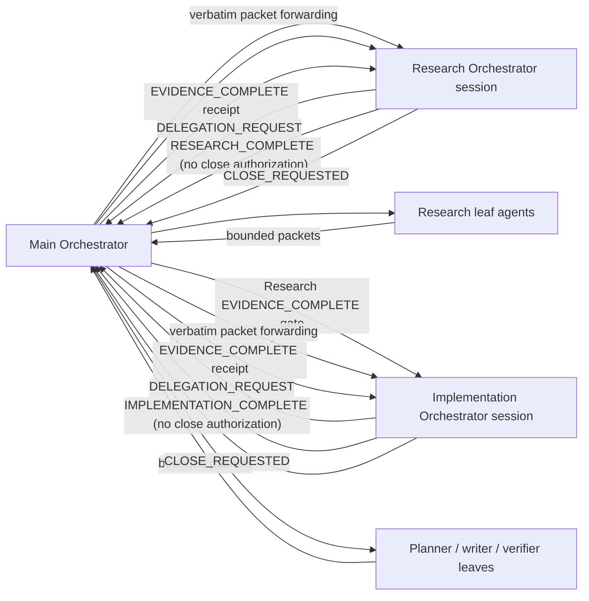

# Codex subagent orchestration과 생명주기

## 1. 결론

Ariadne는 사용자가 요구한 **물리적으로 분리된 Research Orchestrator와 Implementation Orchestrator session**을 유지한다. main이 이들의 분해·종합 책임을 흡수하지 않는다.

이전 planning record의 current-surface 관찰은 다음과 같다. Raw host transcript가 저장소에 없으므로 behavior validation이나 보편적 제품 사실로 credit하지 않는다.

- subagent 안에는 다시 descendant를 spawn·wait·close하는 control이 노출되지 않았다.
- main이 completed orchestrator thread에 packet을 보내 같은 session을 이어가는 것은 성공했다.

따라서 초기 구현은 **의사결정은 계층형, tool control은 main이 대행하는 host-mediated hierarchy**다.



main은 spawn·send·wait·stop·close의 **control-plane proxy**다. Research/Implementation Orchestrator는 작업 분배, packet 품질, follow-up, critic, session 완료의 **decision owner**다. main은 안전·권한·scope 위반이 아닌 한 delegation manifest를 다시 설계하지 않는다.

## 2. Codex가 현재 지원하는 것과 보장하지 않는 것

### 공식 지원 범위

| 기능 | 현재 확인 | Ariadne 사용 |
|---|---|---|
| multi-agent | 현재 Codex release에서 기본 활성화 | 별도 orchestration runtime 없이 사용 |
| 호출 trigger | 직접 prompt, 적용되는 `AGENTS.md`, Skill 지침 | `ariadne-workflow`가 조건과 역할 계약 제안 |
| host orchestration | spawn, follow-up routing, wait, 결과 수집, thread close | tool 이름을 workflow API처럼 하드코딩하지 않음 |
| 진행 제어 | surface에 따라 thread inspect, steer, stop, completed close | main은 control executor·handle custodian, Session Orchestrator는 leaf decision owner |
| project custom agent | `.codex/agents/*.toml` | 반복 검증된 역할만 승격 |
| agent configuration | model, reasoning effort, sandbox, MCP, skills config | 역할별 최소 권한·Model Binding 적용 |
| 동시성 설정 | `agents.max_concurrent_threads_per_session` | baseline 뒤 측정된 상한만 project config 후보로 둠 |
| 권한 상속 | parent sandbox·permission과 live override를 child에 적용 | spawn 전 parent permission 확인, reviewer는 read-only 우선 |

Role Contract의 `read-only`나 write ownership은 behavioral instruction이다. ad hoc agent가 writable parent permission을 상속하면 그 문장만으로 filesystem 권한이 줄어들지 않는다. `effective_permission`과 enforcement source를 기록하고, host/custom-agent sandbox가 없으면 diff 검증 전까지 “강제된 read-only”라고 표현하지 않는다.

### 기록된 현재 환경 probe

2026-08-02 planning record에는 orchestrator subagent의 descendant spawn이 `tools.spawn_agent is not a function`으로 실패하고 같은 orchestrator agent의 main-mediated continuation은 성공했다고 적혀 있다. 저장소에 raw host transcript가 없으므로 이 기록은 architecture premise를 보수적으로 제한하는 근거일 뿐 현재 behavior validation이나 공개 Codex 전체의 영구 한계 증거가 아니다.

### 필수 전제로 두지 않는 것

- prompt가 요구한 정확한 fan-out 수·순서가 매번 결정적으로 실행된다는 보장
- 모든 Codex surface에서 nested subagent가 다시 agent를 spawn하는 동일한 동작; 현재 surface에서는 실제로 실패함
- 자동 deadline 판정, retry, stale-result 폐기와 cleanup이 Ariadne 정책대로 수행된다는 보장
- process·app restart를 넘는 workflow checkpoint·resume
- subagent의 summary나 agent 간 합의가 의미적으로 참이라는 보장

향후 descendant control이 노출되면 Research/Implementation Orchestrator가 manifest를 직접 실행할 수 있다. 그때도 decision contract와 packet 경계는 유지한다. 반대로 main proxy를 거치지 않는 완전한 nested control이 실제 제품 요구가 되면 PLAN-0002를 확장하지 않고 [`architecture.md`](architecture.md)의 evidence-triggered 새 decision 조건으로 보낸다.

## 3. 언제 spawn하는가

Quick은 main 한 명이 기본이다. Standard/Deep에서 해당 연구 또는 구현 phase가 열리면 먼저 **물리적인 session orchestrator**를 spawn한다. 분리 가치가 없을 만큼 단순하면 session을 생략하는 대신 작업 자체를 Quick로 낮출 수 있는지 판단한다.

- 외부·다중 source 연구가 열리면 Research Orchestrator를 우선한다.
- 여러 단계 구현·검증이나 둘 이상의 worker 역할이 필요하면 Implementation Orchestrator를 우선한다.
- 둘 다 필요하면 Research Orchestrator가 `RESEARCH_COMPLETE`를 반환한 뒤 main이 raw evidence를 독립 검사하고 `EVIDENCE_COMPLETE`를 기록·회신해야 Implementation session을 연다. Research close 확인은 별도 control 결과이며 dependency gate가 아니다.
- Session Orchestrator가 실패·미지원이면 새 물리적 Session Orchestrator에 stable packet을 넘기거나 `NEEDS_DECISION / BLOCKED`로 보낸다. main이 leaf 분해·종합을 대신하거나 PLAN-0002 runtime으로 우회하는 fallback은 금지한다.

Session Orchestrator는 다음 신호를 종합해 leaf wave를 요청한다. 고정 점수나 최소 개수는 없으며, 하나만 있어도 decision에 material하면 충분하다.

- 서로 독립적인 risk axis나 source lane이 둘 이상이다.
- 읽기·로그·자료량이 main context를 오염시킬 수 있다.
- 서로 다른 전문성이나 fresh-context 비판이 실제 결정을 바꿀 수 있다.
- deterministic verification을 다른 작업과 동시에 실행할 수 있다.
- 최종 판정이 경쟁하는 claim 비교에 의존한다.

다음이면 leaf를 요청하지 않거나 순차 위임한다.

- 한 결과가 다음 역할의 설계를 바꾼다.
- 하나의 일관된 mental model을 쪼개면 손실이 더 크다.
- 같은 파일·같은 책임 영역을 동시에 수정해야 한다.
- 엄밀해 보이게 만들 목적 외에 독립성이 없다.

초기 leaf wave는 최대 3개를 기본값으로 한다. 더 많은 agent가 필요하면 Session Orchestrator가 각 역할의 독립성, 검증할 packet 수, host concurrency와 추가 사용량을 `DELEGATION_REQUEST`에 설명한다. 이것은 hard platform limit가 아니라 과도한 fan-out을 막는 Ariadne 기본값이다.

현재 surface에서는 Session Orchestrator가 leaf contract를 만들고 main이 이를 그대로 실행한다. main은 다음 경우에만 요청을 거절·수정 요청한다.

- 사용자·system·repository scope 또는 permission 위반
- overlapping write ownership
- host concurrency·tool availability 위반
- secret·비가역 side effect·approval 누락

거절 시 main이 대체 분해안을 만들지 않고 이유를 Session Orchestrator에 돌려보내 재계획하게 한다.

## 4. Role Contract

### Session Orchestrator Contract

main이 Research/Implementation Orchestrator를 열 때 다음을 준다.

```text
session_id_and_mode: research | implementation
contract_revision:
user_outcome_and_completion_contract:
document_binding_and_input_artifacts:
decision_authority_and_forbidden_scope:
delegation_budget: initial leaves / follow-up rounds
required_final_packet: phase_verdict / recommended_next_action / accepted_outputs / evidence_locators / leaf_dispositions / unresolved_risks
model_binding:
session_stale_if:
checkpoint:
control_proxy: main
```

Session Orchestrator는 다음 message type 중 하나로 main에 응답한다.

- `DELEGATION_REQUEST`: 독립 leaf contract 목록과 의존성·병렬화 이유
- `FOLLOW_UP_REQUEST`: 기존 packet의 material gap을 해결하는 좁은 추가 요청
- `RESEARCH_COMPLETE` 또는 `IMPLEMENTATION_COMPLETE`: `phase_verdict=COMPLETE`, 다음 작업 권고, 근거·leaf disposition을 포함하지만 close authorization은 포함하지 않는 phase semantic packet
- `INSUFFICIENT_EVIDENCE`: 현재 budget·source로 phase 결론을 닫을 수 없다는 판정과 재개 조건
- `NEEDS_DECISION`: 근거만으로 닫을 수 없는 owner 선택
- `SESSION_FAILED`: 실패 원인, 이미 얻은 증거와 재개 조건
- `CLOSE_REQUESTED`: main이 `EVIDENCE_COMPLETE` receipt를 같은 session에 보낸 뒤 owner가 별도 message로 반환하는 close authorization

Codex host가 orchestrator의 한 turn을 `completed`로 표시한 것은 turn scope의 `TERMINAL_HOST(completed)`일 뿐 phase semantic packet이 아니다. `DELEGATION_REQUEST` 뒤 turn이 끝나도 thread를 close하지 않고 leaf packet을 같은 session에 follow-up으로 보낸다. Phase 종료는 위 phase semantic packet으로 판정한다. Main은 이후 raw evidence를 독립 검사해 `EVIDENCE_COMPLETE` receipt 또는 `EVIDENCE_MISMATCH` notice를 같은 session에 보내고, owner의 별도 `CLOSE_REQUESTED`가 오기 전에는 host close를 호출하지 않는다.

### Leaf Contract

Session Orchestrator가 만든 각 leaf contract는 다음을 포함한다. main은 safety validation 뒤 의미를 바꾸지 않고 spawn prompt로 전달한다.

```text
leaf_id_and_objective:
contract_revision:
parent_session_id:
dependencies:
inputs_and_forbidden_scope:
task_and_output_evidence:
success_and_stop:
side_effects_and_write_ownership:
effective_permission: value / host-sandbox | custom-agent | instruction-only
model_binding:
stale_if:
checkpoint:
decision_owner: parent Session Orchestrator
control_proxy: main
```

추가 규칙:

- reviewer·researcher·critic은 read-only가 기본이다. parent가 writable이고 per-agent sandbox가 없으면 이는 instruction-only이며 main이 agent 전후 diff를 확인한다.
- writer는 disjoint write ownership과 다른 writer의 존재를 명시한다.
- intended answer, 이전 critic의 결론, 숨은 grading key를 독립 role에 주지 않는다.
- `stale_if`에는 base revision, 전제 문서, 계획 변경 또는 겹치는 파일 변경처럼 결과를 다시 확인해야 하는 조건을 넣는다.

## 5. Context Boundary와 packet 전달

계층형 위임의 목적은 역할 연출이 아니라 context 오염을 줄이는 것이다.

- main은 Session Orchestrator에 사용자 요구, completion contract, 관련 project/convention 문서와 이전 session의 **최종 packet**만 준다. 불필요한 전체 대화 history는 주지 않는다.
- leaf는 main history나 Session Orchestrator의 intended conclusion을 받지 않는다. 자신의 source·파일·검증 범위만 받는다.
- leaf는 raw 로그·긴 원문을 main 응답에 붙이지 않고 `claim/finding, evidence locator, limitation, verdict`의 bounded packet을 반환한다. 큰 artifact는 path·URL·command locator로 참조한다.
- main은 leaf packet을 재요약·선별하지 않고 parent Session Orchestrator thread에 stable block으로 전달한다. transport 중 safety redaction이 필요하면 무엇을 제거했는지 표시한다.
- Research/Implementation Orchestrator가 packet의 관련성·품질·충돌·추가 조사 필요를 판정한다.
- main은 전체 목표의 다음 phase 판단에 leaf packet 묶음이 아니라 phase semantic disposition과 evidence disposition을 함께 사용한다. 특히 dependent Implementation은 `RESEARCH_COMPLETE`만으로 열지 않고 Research `EVIDENCE_COMPLETE`를 요구한다. Material claim 검증 시 locator를 직접 열고 mismatch가 있으면 자신의 결론으로 덮지 않고 같은 Session Orchestrator에 `EVIDENCE_MISMATCH`를 보낸다.

현재 surface에서는 main이 tool result를 수신하므로 leaf packet이 main context를 완전히 통과하지 않는 것은 불가능하다. 따라서 bounded packet과 raw-artifact locator로 오염을 제한한다. 완전한 context 격리가 실제 필수 요구가 되면 PLAN-0002 밖에서 새 evidence-backed decision을 검토한다.

## 6. 실행 생명주기

이 절은 Ariadne agent lifecycle 분류의 **유일한 normative owner**다. 다른 문서는 이 절을 링크해 사용하고 같은 분류를 다시 정의하지 않는다. 다음 값은 기록용 관찰·판정 어휘이며 별도 state machine enum이나 transition reducer가 아니다.

### 서로 직교하는 여섯 차원

각 handle은 다음 여섯 차원을 따로 기록한다. 한 차원의 값으로 다른 차원을 추론하지 않는다.

| 차원 | 값 | 판정 근거와 의미 |
|---|---|---|
| host observation | `ACTIVE_OBSERVED` | 해당 handle과 상관관계가 확인된 명시적 nonterminal host status 또는 event가 있다. 긴 경과 시간이나 높은 reasoning 자체는 이 값의 근거가 아니다. |
| host observation | `WAITING_KNOWN(reason, owner, resume_condition)` | `barrier / dependency / approval / user_input / tool` 중 이유와 대기 해소 owner, 재개 조건을 모두 안다. `NEEDS_INPUT`은 terminal verdict가 아니라 이 값으로 기록하는 일시적 관찰이다. |
| host observation | `UNOBSERVABLE` | 현재 상관관계가 확인된 signal이 없거나 surface가 control/status를 노출하지 않는다. 지연, 실패, interruption, completion 중 어느 것도 뜻하지 않는다. |
| host observation | `TERMINAL_HOST(outcome)` | 상관관계가 확인된 명시적 terminal signal이 있고 `outcome`은 `completed / failed / interrupted` 중 하나다. signal의 `spawn / item / turn / agent / session` scope와 관찰 가능한 retryability를 보존한다. |
| contract currency | `CURRENT` | 결과가 objective, inputs와 현재 contract revision에 계속 부합한다. |
| contract currency | `STALE` | objective가 바뀌었거나 premise가 무효화됐거나 contract revision이 맞지 않는다. |
| phase semantic disposition | `NONE_RECORDED` | 해당 phase owner의 semantic packet이 아직 관찰되지 않았다. host signal에서 phase 의미를 추론하지 않는다. |
| phase semantic disposition | `RESEARCH_COMPLETE / IMPLEMENTATION_COMPLETE / INSUFFICIENT_EVIDENCE / PARTIAL / BLOCKED / NEEDS_DECISION / SESSION_FAILED` | phase owner가 명시적으로 낸 semantic packet의 type과 verdict를 보존한다. Complete packet에는 close authorization을 넣지 않는다. |
| evidence disposition | `INCOMPLETE` | acceptance evidence 또는 필수 독립 검토 중 하나라도 열려 있다. |
| evidence disposition | `EVIDENCE_COMPLETE` | 명시적 complete phase packet, `CURRENT`, 필수 raw artifact·command result, unresolved raw-evidence mismatch 없음, 독립 검토, Document Impact closure를 main이 직접 확인했다. Host observation이나 close disposition을 이 값으로 추론하지 않는다. |
| inspection trigger | `none / CHECKPOINT_DUE` | `CHECKPOINT_DUE`만 inspect·diagnose를 요청한다. 다른 lifecycle 값은 generic control marker가 아니다. |
| close disposition | `none / CLOSE_REQUESTED / CLOSE_CONFIRMED / CLOSE_UNOBSERVABLE` | owner의 별도 요청, 실제 host 확인, 또는 확인 불가능 limitation을 각각 기록한다. |

`CHECKPOINT_DUE`는 status를 inspect·diagnose하라는 유일한 inspection/control marker일 뿐 lifecycle 또는 completion verdict가 아니다. Contract가 inspection을 허용할 때 silence, 경과 시간, wait timeout 또는 checkpoint arrival가 만들 수 있는 것은 `CHECKPOINT_DUE`뿐이다. 이 신호들만으로 host observation을 바꾸거나 failed·stalled·interrupted·completed·deadline failure를 추론하지 않는다.

`NEEDS_INPUT`은 reason·owner·resume condition이 있는 `WAITING_KNOWN`의 source message이고, `EVIDENCE_MISMATCH`는 evidence가 `INCOMPLETE`인 동안 owner에게 보내는 finding이다. Phase packets는 phase semantic disposition에, `CLOSE_*` 값은 close disposition에만 기록한다. 이들 중 어느 것도 generic control marker가 아니다.

### Completion과 close 경계

다음 경계는 서로 대체할 수 없다.

1. **Phase semantic packet**: phase owner가 `RESEARCH_COMPLETE` 또는 `IMPLEMENTATION_COMPLETE`를 close authorization 없이 반환한다. Host turn/item completion으로 만들거나 추론하지 않는다.
2. **Independent evidence receipt**: main이 current raw artifacts·command results, mismatch resolution, fresh independent review와 Document Impact를 직접 검사한 뒤에만 `EVIDENCE_COMPLETE`를 기록한다.
3. **Receipt handoff**: main은 `EVIDENCE_COMPLETE` receipt를 같은 phase owner session에 보낸다. Mismatch가 있으면 대신 `EVIDENCE_MISMATCH`를 보내고 evidence는 `INCOMPLETE`로 유지한다.
4. **Close request**: phase owner는 matching `EVIDENCE_COMPLETE` receipt를 받은 뒤 별도 `CLOSE_REQUESTED` message를 낸다.
5. **Host close evidence**: main은 host close를 호출하고 실제 host confirmation이 있으면 `CLOSE_CONFIRMED`, confirmation surface가 없으면 limitation과 함께 `CLOSE_UNOBSERVABLE`을 기록한다.

Research `EVIDENCE_COMPLETE`가 dependent Implementation의 gate다. `RESEARCH_COMPLETE` alone은 부족하고 Research close confirmation은 이 dependency와 별개다.

### Spawn 전

main은 Session Orchestrator contract, parent permission, Model Binding과 checkpoint를 확인해 session을 먼저 연다. Session Orchestrator가 `DELEGATION_REQUEST`를 반환하면 main은 safety·scope·host feasibility만 검사한다. leaf의 dependency·독립성·output contract를 결정하는 책임은 Session Orchestrator에 있다. dependent 역할을 미래 결과를 추측해 미리 spawn하지 않는다.

### Running

- main은 다른 session을 섞어 열지 않고 사용자 요구·전체 plan·session lifecycle에 집중한다. 연구나 구현 내용을 대신 수행하지 않는다.
- status 확인은 다음 행동이 agent 결과에 막혔거나 contract의 checkpoint 조건이 충족돼 `CHECKPOINT_DUE`일 때만 한다.
- leaf가 완료되면 main은 packet을 parent Session Orchestrator에 전달한다. packet의 채택·보완·기각은 Session Orchestrator가 판정한다.
- scope가 유지되지만 빠진 입력이 있으면 decision owner가 만든 한 번의 좁은 steer를 main이 전달한다.
- 요구나 계획이 바뀌어 objective가 달라졌으면 steer로 억지 전환하지 않고 기존 contract를 `STALE`로 판정한 뒤 새 revision의 contract를 만든다.
- approval·user input·dependency·tool 대기가 명시적으로 관찰되면 owner와 resume condition을 포함한 `WAITING_KNOWN`으로 기록한다. non-interactive surface가 요청을 지원하지 않아 명시적 failure signal을 반환한 경우에만 그 signal의 scope를 failure evidence로 쓴다.

### Wait와 barrier

모든 agent를 spawn하자마자 반복 polling하지 않는다. Session Orchestrator가 요청한 barrier에서만 필요한 leaf를 기다린다. 일부 leaf가 먼저 끝나면 packet을 parent session에 전달할 수 있지만, Session Orchestrator가 모든 lane을 요구하면 누락된 lane을 숨기지 않는다.

### Completion과 integration

1. main은 host observation만이 아니라 bounded packet과 evidence reference를 parent session에 전달한다.
2. Session Orchestrator는 locator·diff·command output과 contract revision을 확인해 contract currency를 `CURRENT / STALE`로 판정하고 leaf를 `adopted / partially_adopted / rejected / stale / follow_up`으로 disposition한다.
3. Phase owner는 모든 phase disposition을 마치면 `RESEARCH_COMPLETE` 또는 `IMPLEMENTATION_COMPLETE`를 close authorization 없이 보낸다.
4. main은 material claim·write scope·permission, raw artifact·command result, fresh independent review와 Document Impact를 직접 검사한다. Packet과 raw evidence가 불일치하면 `EVIDENCE_MISMATCH`를 같은 owner에게 보내 revised disposition을 요청하며 evidence는 `INCOMPLETE`로 둔다.
5. mismatch가 없고 gate가 모두 닫히면 main이 `EVIDENCE_COMPLETE`를 기록하고 그 receipt를 같은 phase owner에게 보낸다.
6. matching receipt를 받은 phase owner가 별도 `CLOSE_REQUESTED`를 보낸다. 이 close disposition은 phase packet이나 evidence disposition을 다시 쓰지 않는다.
7. main은 host close를 호출한 뒤 실제 host evidence에 따라 `CLOSE_CONFIRMED` 또는 limitation을 포함한 `CLOSE_UNOBSERVABLE`을 기록한다.
8. Research evidence가 complete이면 dependent Implementation을 열 수 있다. Research close confirmation을 기다리거나 close 결과를 evidence completion으로 대체하지 않는다.

Leaf thread close도 차원을 섞지 않는다. Parent phase owner가 leaf packet을 disposition한 뒤 별도 `CLOSE_REQUESTED`를 보내고, main이 host close를 호출해 실제 evidence로 close disposition을 기록한다. 이 leaf close는 phase semantic disposition이나 phase evidence disposition을 만들지 않는다.

host가 thread를 자동으로 닫는 정확한 시점을 가정하지 않는다. close가 노출된 surface에서는 disposition이 끝난 terminal agent를 불필요하게 열어두지 않는다. 후속 질문이 실제로 예정된 agent만 잠시 유지한다.

각 wave barrier가 끝나면 main은 control-plane terminal sweep을 한 번 수행한다. Session Orchestrator의 leaf disposition과 실제 host observation을 대조해 아직 필요한 `ACTIVE_OBSERVED / WAITING_KNOWN / UNOBSERVABLE` agent와 close가 확인되지 않은 `TERMINAL_HOST` agent를 구분한다.

### Checkpoint, deadline, failure

- Ariadne에는 event silence나 경과 시간으로 만드는 일반 terminal 상태가 없다. `CHECKPOINT_DUE`이면 known wait, tool failure, scope error, transport loss 또는 단순 지연을 진단하고 현재 host observation을 그대로 보존한다.
- 모든 error signal이 terminal failure는 아니다. retriable 또는 nonterminal로 표시된 error를 `TERMINAL_HOST(failed)`로 축약하지 않고 source signal, scope와 관찰 가능한 retryability를 보존한다.
- 외부 deadline을 contract에 의도적으로 설정했고 그 deadline이 실제로 발화했다는 명시적 signal이 있을 때만 configuration, signal, 실패 scope와 retryability를 함께 기록해 scoped failure evidence로 쓸 수 있다. checkpoint 도달이나 침묵만으로는 deadline failure가 아니다.
- objective가 유효하면 Session Orchestrator가 한 번의 좁은 steer 또는 근거 있는 deadline 변경을 요청할 수 있다.
- 같은 contract·model·입력으로 blind respawn하지 않는다. Session Orchestrator가 실패 원인에 따라 context, tool, model, scope 또는 계획 중 하나를 바꾼 새 request를 만든다.
- branch 전제가 깨지면 Session Orchestrator가 관련 contract currency를 `STALE`로 판정하고 main이 실행 중 thread를 stop/cancel한다.
- 결과 없이 닫힌 lane이 material하면 Session Orchestrator는 완료 packet을 내지 않고 재계획·`INSUFFICIENT_EVIDENCE`·`NEEDS_DECISION` 중 하나를 반환한다.
- Session Orchestrator 자체가 실패하면 main은 stable input·packet ledger로 replacement session을 열 수 있다. replacement도 실패하거나 continuity가 material하면 main이 내용을 대신 수행하지 않고 `BLOCKED / NEEDS_DECISION`으로 보낸다. Runtime은 PLAN-0002 fallback이 아니다.

## 7. 최소 Lifecycle Ledger

Standard/Deep에서 agent가 둘 이상이면 static role/model 정보를 반복하지 않고 main plan이나 실행 기록에 다음 한 표만 둔다.

| logical id / handle | contract revision / decision owner / dependency | host observation / source·evidence / last observed / limitation | terminal scope·outcome / retryability | contract currency / phase / evidence disposition / packet refs | inspection trigger / close disposition |
|---|---|---|---|---|---|
| R1.L1 / surface handle | rev-1 / R1 / none | `ACTIVE_OBSERVED` / correlated host event / observed-at / none | n/a / n/a | `CURRENT` / `NONE_RECORDED` / `INCOMPLETE` / packet pending | `none` / `none` |

main은 control을 위해 handle, contract revision, observation source와 evidence, last observed, 관찰 limitation, 그리고 관찰 가능한 경우 terminal scope·outcome·retryability를 기록한다. Session Orchestrator는 phase packet에 contract currency와 leaf disposition을 포함하고, main은 evidence·inspection·close 차원을 별도로 기록한다. 한 agent만 쓰는 작업은 별도 ledger 문서를 만들지 않는다.

## 8. Custom agent 생명주기

처음에는 ad hoc role contract를 쓴다. 같은 역할이 반복됐다는 이유만으로 custom agent를 만들지 않는다.

```text
ad-hoc candidate
-> evaluated candidate
-> active project custom agent
-> review-needed
-> updated | retired
```

승격 조건:

- 서로 다른 실제 작업에서 같은 역할이 3회 이상 유용했다.
- 일반 prompt 대비 role contract 누락·품질·사용량 개선 가설이 있다.
- [`model-selection.md`](model-selection.md)의 model calibration을 통과했다.
- sandbox·MCP·skills가 역할의 최소 권한으로 정해졌다.
- held-out forward test에서 adjacent role로 drift하지 않았다.

운영 규칙:

- built-in agent 이름을 덮어쓰지 않도록 `ariadne_` prefix를 쓴다.
- `.codex/agents/<role>.toml`에는 `name`, `description`, `developer_instructions`와 검증된 최소 config만 둔다.
- concrete model, Codex config schema, dependency 또는 역할 경계가 바뀌면 `review-needed`로 본다.
- 세 번 이상의 예외·scope drift·반복된 명시적 deadline failure 또는 일반 prompt 대비 이점 상실이 생기면 update/retire를 검토한다.
- 첫 custom agent가 생기기 전에는 빈 registry나 project concurrency config를 만들지 않는다.

## 9. 초기 configuration 결정

현재는 `.codex/config.toml`과 `.codex/agents`를 만들지 않는다.

- 역할마다 model 요구가 다르므로 하나의 `default_subagent_model`로 모두 덮지 않는다.
- `max_concurrent_threads_per_session`은 B10 lifecycle baseline에서 context·사용량·cleanup 결과를 측정한 뒤 정한다.
- 첫 승격 후보는 반복 사용이 확정된 `ariadne_research_orchestrator`와 `ariadne_implementation_orchestrator`다. 그다음이 read-only evidence scout와 independent risk reviewer다.
- write agent는 ownership·worktree·검증 방식이 실제 pilot에서 안정된 뒤에만 고정한다.

## 10. 근거와 검증 상태

2026-08-02 확인한 공식 [Codex Subagents](https://learn.chatgpt.com/docs/agent-configuration/subagents)는 multi-agent availability, prompt·project·Skill trigger, host orchestration, inspect·steer·stop·close, custom agent schema, model·effort·sandbox와 concurrency 설정을 설명한다. [Codex Models](https://learn.chatgpt.com/docs/models)는 subagent 사용량과 model/effort trade-off의 근거다.

공식 문서가 Ariadne의 최대 3개 leaf, host-mediated hierarchy, lifecycle state 이름과 승격 기준을 정해주는 것은 아니다. Nested-spawn 실패와 continuation 성공은 raw host transcript가 없는 planning record이므로 direct execution evidence로 credit하지 않는다. 전체 behavior는 PLAN-0002의 B10/B11과 실제 pilot 전까지 `unvalidated`다.
