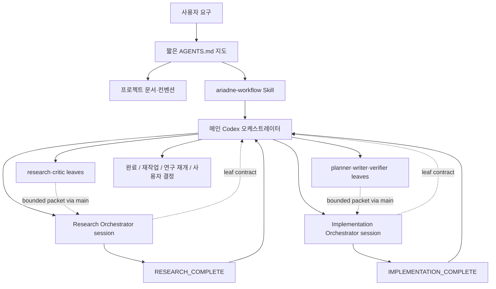

# Ariadne Forge 아키텍처

## 한 문장 구조

Ariadne는 별도 workflow engine이 아니라 **얇은 저장소 지침 + 하나의 진입 Skill + Codex의 기본 작업·subagent 기능 + 직접 확인 가능한 검증 증거**로 시작한다.



점선 경로에서 main은 Codex host control을 대행할 뿐, leaf 분해와 packet 의미 판정을 넘겨받지 않는다. 이 구조는 논리적으로 계층형이고 현재 surface에서는 host-mediated다.

## 구성 요소

### 1. Repository knowledge

- `AGENTS.md`: 자동으로 로드되는 짧은 지도와 최소 안전 규칙
- `docs/project.md`: 변하지 않는 목표와 비목표
- `docs/architecture.md`: 현재 구현 구조와 승격 조건
- `docs/operating-model.md`: 작업 흐름과 역할·근거 계약
- `docs/model-selection.md`: 안정적인 역량 profile과 현재 모델·reasoning mapping
- `docs/agent-orchestration.md`: subagent topology, role contract, wait·steer·stop·close 생명주기
- `docs/conventions/`: 범위별 active convention과 등록부
- `docs/decisions/`: 되돌리기 어렵거나 넓은 영향을 가진 선택의 이유
- `docs/plans/`: 장기·복합 작업의 실행 기록
- `docs/research/`: 출처, 주장, 충돌과 한계를 보존하는 advisory 자료

### 2. Repository-scoped entry Skill

첫 구현 대상은 다음 하나뿐이다.

```text
.agents/skills/ariadne-workflow/
└── SKILL.md
```

`SKILL.md`의 한 가지 일은 evidence-first 개발 workflow를 지휘하고 현재 repository 권위 문서를 필요한 시점에 읽게 하는 것이다. `docs/operating-model.md`의 내용을 Skill 전용 reference에 복제하지 않는다. 반복 누락이 forward test에서 관측될 때만 좁은 reference를 추가하고, UI metadata나 암시 호출 제어가 실제로 필요할 때만 `agents/openai.yaml`을 추가한다. 초기 package에는 자체 runtime, DB, workflow DSL, network service를 넣지 않는다.

Skill의 상태는 package 생성 직후에도 `UNVALIDATED_DRAFT`다. 정적 검사와 실제 Codex forward test를 모두 통과하기 전에는 ready라고 부르지 않는다.

### 3. Main orchestrator

메인 Codex 세션은 다음만 소유한다.

- 요구사항과 완료 계약 확인
- 임시 작업 경로 선택과 재평가
- 필요한 문서 바인딩 확인
- 해당 phase의 Research/Implementation Orchestrator session 생성과 final packet의 구조·안전·raw-evidence mismatch 확인
- session orchestrator가 요청한 역할·모델·병렬화 manifest의 안전·권한·write overlap·host feasibility 검사
- spawn·send·wait·stop·close handle과 terminal 상태 관리
- leaf packet을 의미 재종합 없이 parent session에 전달하고, material locator·diff·실행 결과를 직접 확인
- Session Orchestrator의 `phase_verdict`와 `recommended_next_action`을 입력으로 전체 사용자 목표의 다음 phase 또는 중단 상태 결정
- 사용자에게 근거와 남은 위험을 포함한 최종 보고

Quick 작업은 직접 답하거나 구현할 수 있다. Standard/Deep에서 해당 연구·구현 phase가 열리면 main은 leaf 분해·연구 종합·구현 진행 판정을 직접 흡수하지 않는다. Session Orchestrator가 실패하면 새 물리적 Session Orchestrator에 stable packet을 넘기거나 `NEEDS_DECISION / BLOCKED / runtime escalation`로 끝낸다. main-owned leaf 분해로 fallback하지 않는다.

### 4. Research/Implementation Orchestrator

두 역할은 이름만 붙인 논리적 단계가 아니라 main과 분리된 물리적 Codex session이다.

- **Research Orchestrator**: 결정 질문과 source plan 수립, research·critic leaf 계약, packet 품질·충돌·반례 판정, 좁은 follow-up, 비판 disposition, `RESEARCH_COMPLETE` 보고를 소유한다.
- **Implementation Orchestrator**: acceptance criterion을 단계·dependency·write ownership으로 분해하고 planner·writer·verifier leaf 계약, 단계 진척·stale·재계획, 계획 비판과 구현 검증 disposition, `IMPLEMENTATION_COMPLETE` 보고를 소유한다.
- 둘 다 main에 `DELEGATION_REQUEST`를 보내며, 현재 surface에서는 main이 host tool을 대행하고 결과 packet을 같은 session에 돌려준다.
- main은 안전·권한·scope·host 가능성 외의 이유로 manifest를 다시 설계하거나 leaf 결과 중 편한 것만 골라 전달하지 않는다.

### 5. Ephemeral leaf roles first

초기 research scout·비판자·planner·구현자·검증자는 parent Session Orchestrator가 만든 명확한 role contract를 받은 ad hoc subagent다. custom agent를 선제적으로 많이 만들지 않는다.

Role contract에는 반드시 다음을 넣는다.

- objective와 입력
- writable paths와 forbidden paths
- 반환 형식과 근거 요구
- 검증 방법
- model profile·reasoning effort 추천, 근거와 escalation condition
- parent session, dependency, stale condition, timebox/checkpoint, decision owner와 main control proxy
- stop condition
- 다른 writer가 있는지와 소유 범위

같은 역할이 반복되고 일반 prompt보다 더 나은 결과를 낸다는 forward test가 쌓이면 `.codex/agents/<role>.toml`로 승격한다. 모델과 `model_reasoning_effort`를 재현 가능하게 고정할 때도 [`model-selection.md`](model-selection.md)의 인접 configuration 비교와 [`agent-orchestration.md`](agent-orchestration.md)의 custom agent 생명주기를 먼저 충족한다.

## Codex 지원 경계

| 항목 | 현재 확인 | 설계상 의미 |
|---|---|---|
| repo Skill discovery | `$REPO_ROOT/.agents/skills` 공식 지원 | Skill 원본을 저장소에 둔다. 별도 설치 script 불필요 |
| Skill activation | 명시적 `$skill`과 description 기반 암시 호출 | 중요 pilot은 명시 호출로 테스트한다 |
| subagent 요청 | 사용자·AGENTS·Skill 지침으로 요청 가능 | 읽기 중심 병렬 조사와 독립 검토에 사용 |
| host orchestration | spawn, follow-up routing, wait, 결과 수집, thread close 지원 | 별도 manager runtime 없이 main이 control-plane proxy 역할 수행 |
| inspect·steer·stop·close | app/CLI/IDE surface별 control 지원 | surface 차이를 숨기지 않고 지원되는 control만 사용 |
| project custom agents | `.codex/agents/*.toml` 지원; format은 발전 가능 | 반복 역할을 나중에 승격하고 migration 조건 기록 |
| 모델·effort·sandbox | custom agent 또는 spawn/config에서 설정 가능; parent live permission 상속 | Skill 텍스트만으로 강제됐다고 주장하지 않음 |
| 동시 thread 상한 | `agents.max_concurrent_threads_per_session` 지원 | baseline 전 project 값 고정하지 않음 |
| Skill 간 직접 호출 API | 확인되지 않음 | Skill 체인을 결정적 함수 호출처럼 설계하지 않음 |
| 정확한 fan-out·순서 | 명시 요청은 지원되지만 deterministic 실행 보장은 문서화되지 않음 | Session Orchestrator의 manifest와 barrier를 main이 실행하고 실제 spawn·완료를 확인 |
| descendant spawn | 현재 probe에서 subagent 내부 `spawn_agent`가 노출되지 않아 실패 | direct nested control 대신 main이 host control만 대행 |
| orchestrator continuation | 현재 probe에서 동일 orchestrator thread에 packet 전달 후 후속 판단 성공 | 물리적 session과 decision ownership을 leaf wave 사이에도 유지 |
| 완전한 context 격리 | main이 host tool result를 수신하므로 현재 surface에서는 불가능 | bounded packet·raw artifact locator로 오염 제한; 완전 격리가 필수면 runtime 승격 |
| 의미 기반 근거 검증 | 기본 제공 아님 | schema/link 검사와 semantic review를 분리 |
| 문서만으로 path write 강제 | 보장되지 않음 | 권한 모드, 소유 범위, diff 검증을 함께 사용 |

동일한 이름의 Skill은 자동 병합되거나 예측 가능한 하나로 shadow된다고 가정하지 않는다. 프로젝트 Skill 이름은 충돌 가능성이 낮은 `ariadne-*` prefix를 쓴다.

## 상태와 영속성

초기에는 상태 reducer를 만들지 않는다.

- 한 대화 안의 작업: Codex plan과 대화 기록
- 복합·장기 작업: `docs/plans/active/`의 Markdown execution plan
- 실제 사실: 현재 파일, Git diff, 명령 종료값, 테스트·브라우저 산출물
- 둘 이상의 agent wave: plan 안의 작은 Lifecycle Ledger; 별도 orchestration DB 없음

다음 상태 이름은 의사소통용이지 코드 state machine enum이 아니다.

```text
INTAKE -> PLANNED -> RESEARCHING? -> IMPLEMENTING? -> VERIFYING
       -> COMPLETE | NEEDS_DECISION | BLOCKED | FAILED | CANCELLED
```

어느 단계에서도 새 근거가 필요하면 `RESEARCHING`, 요구가 틀렸거나 계획이 깨지면 `PLANNED`, 사용자 판단이 필요하면 `NEEDS_DECISION`으로 돌아갈 수 있다.

## 쓰기와 부작용

초기 정책은 “전역 single writer”가 아니다.

- 같은 파일 또는 겹치는 책임 범위에는 동시에 한 writer만 둔다.
- 서로 독립된 파일은 소유 범위를 명시하면 병렬 작성할 수 있다.
- 병합 전에 메인 세션이 전체 diff와 검증 결과를 본다.
- commit, push, 배포, 외부 메시지, 결제, 삭제처럼 외부적·비가역적인 효과는 사용자 권한과 호스트 approval을 요구한다.

범용 Action Broker는 만들지 않는다. Skill 개선 후에도 scope 위반이 반복되면 해당 경로에만 patch proposal + 작은 deterministic applicator를 실험한다.

## 결정론적으로 검사할 것과 의미 판단할 것

| 결정론적 검사 후보 | 의미 검토가 필요한 것 |
|---|---|
| 파일·링크 존재, 필수 절, 허용 status | 요구 해석이 맞는가 |
| Git diff와 writable path 교집합 | 설계가 프로젝트에 적합한가 |
| 명령 종료값, 테스트·lint 결과 | 출처가 주장을 실제로 지지하는가 |
| screenshot·trace artifact 존재 | UI가 목적·위계·사용성을 충족하는가 |
| 명시된 version·digest 형식 | 비판이 타당한가, 반박이 충분한가 |

정적 validator는 왼쪽만 판정한다. 오른쪽까지 검증했다고 표현하지 않는다.

## 런타임 승격 조건

다음 중 하나가 실제 요구나 반복 실패로 확인될 때만 code-first runtime spike를 연다.

- process 종료 후 자동 resume이 필요하다.
- 수시간·수일의 human-in-the-loop 대기가 업무 요구다.
- 외부 event가 안정적으로 workflow를 시작해야 한다.
- 다수 작업의 queue·동시성·재시도·관찰이 필요하다.
- 절차적 Skill로 false-completion 또는 권한 우회를 허용 수준까지 낮추지 못한다.

process 재시작 후 resume은 미래 승격 신호지만 MVP acceptance criterion은 아니다. 따라서 SDK·Agents SDK·LangGraph의 resumability는 현재 채택 근거로 계산하지 않는다.

그때 동일 vertical slice와 동일 평가 budget으로 비교한다.

| 후보 | 적합한 상황 | 해결하지 않는 것 | 현재 판정 |
|---|---|---|---|
| Codex SDK | coding-focused thread handle, 프로그램식 start·continue, CI·내부 자동화, turn별 sandbox | Ariadne의 barrier·stale·authority·semantic evidence 정책을 자동 제공하지 않음 | host 제어 누락이나 자동화 요구가 측정되면 첫 spike 후보 |
| Codex App Server | custom client의 thread·turn·event·approval 관찰과 steer·interrupt | 문서화된 임의 descendant spawn이나 의미 검증을 가정할 수 없음 | event-level control이 material할 때만 비교 |
| OpenAI Agents SDK + Codex MCP | Codex가 더 넓은 manager/tool/handoff workflow의 specialist일 때 | Codex host lifecycle, exactly-once external effect, Ariadne authority protocol을 자동 제공하지 않음 | 현재는 별도 runtime과 이중 상태 부담 때문에 보류 |
| LangGraph | 반복된 phase-order·stale·barrier·retry 오류를 typed state와 transition으로 막을 때 | Codex spawn 권한, source truth, permission isolation, exactly-once effect | Skill 개선 뒤 lifecycle failure가 반복될 때 handwritten transition과 tiny graph를 비교 |
| Microsoft Agent Framework | typed workflow와 Microsoft stack integration이 실제 요구일 때 | 같은 semantic·permission 문제 | 현재 요구 없음 |

Codex SDK는 토큰 절감 기능이 아니라 Codex thread를 프로그램으로 제어하는 표면이다. 같은 prompt·model·reasoning·tool work와 같은 agent 수를 실행한다면 SDK를 쓴다는 사실만으로 토큰이 줄어든다고 가정하지 않는다. 반대로 추가 orchestrator turn, subagent, retry와 긴 thread context가 늘면 총사용량도 늘 수 있다. bounded packet, 불필요한 run 제거, 적절한 model·effort, 동일 thread continuation으로 재작업을 줄이는 경우에만 **전체 작업 완료당** token·비용 감소 가능성을 실험으로 판정한다.

기존 계획의 “Agents SDK는 durable workflow를 제공하지 않는다”는 표현은 현재 sessions·resumable run 지원을 반영하지 못해 폐기한다.

## 외부 디자인 Skill 경계

MengTo/Skills는 디자인 전용 adapter 후보다. 첫 UI pilot 전에는 복사하거나 wrapper Skill을 만들지 않는다.

- reference capture·해석: `stitched-full-page-capture`, `video-to-superprompt`, `html-to-interaction-prompts`
- proposal: `design-first-ui-prompting`과 좁은 layout/motion Skill
- 보조 QA: originality·animation·performance 관련 Skill

외부 Skill의 산출물은 후보와 관찰이다. 프로젝트 목적, active convention, 접근성, 반응형·상태 동작, 성능, 독창성, 실제 브라우저 결과가 최종 판단 근거다. vendoring이 필요해지면 license, upstream revision, digest와 수정 내역을 별도 결정으로 기록한다.
