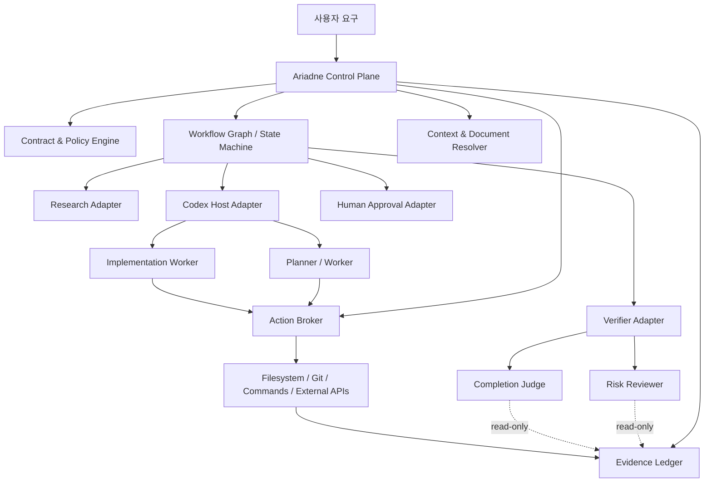
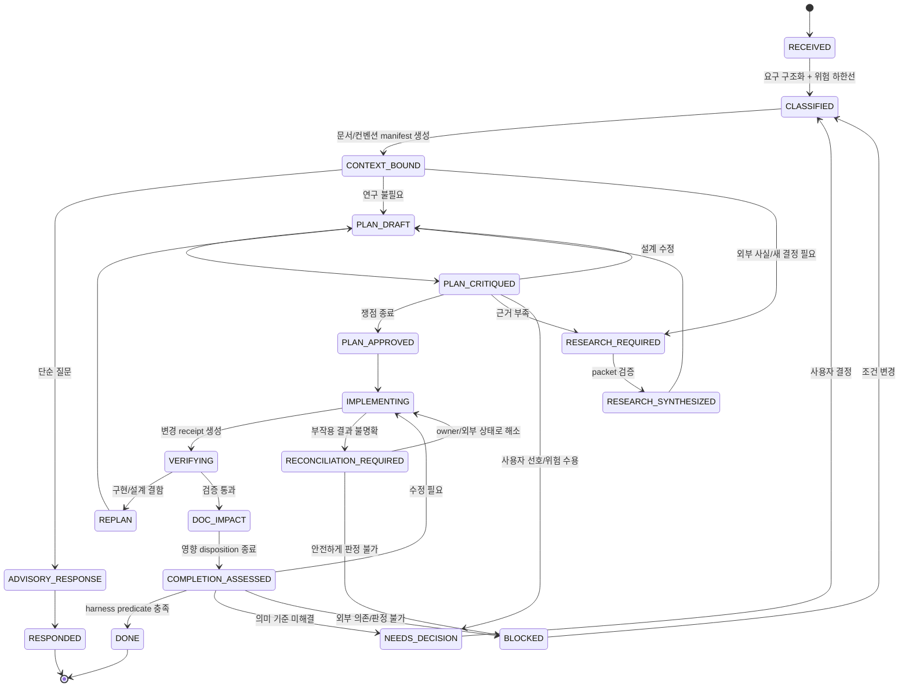
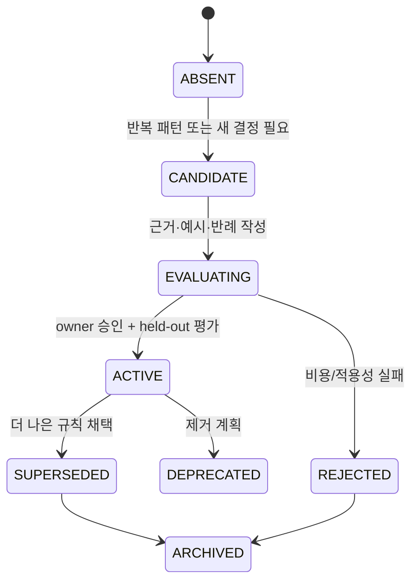

# Ariadne Forge 기반 설계 및 구현 전 계획

> 이 문서는 초기 대안과 조사 이력을 보존하기 위한 기록이다. 구현 기준으로 사용하지 않는다. 현재 계획은 [`0002-codex-native-skill-first-plan.md`](0002-codex-native-skill-first-plan.md)이며, 현재 규범은 [`../../operating-model.md`](../../operating-model.md)와 [`../../architecture.md`](../../architecture.md)에 있다.

## 0. 결론부터

이 프로젝트의 핵심은 “AI가 판단하지 않게 만드는 것”이 아니라 **AI의 판단이 곧바로 권한 있는 결정이 되지 못하게 만드는 것**이어야 한다.

LLM은 요구사항 해석, 후보 계획 생성, 의미 판단, 구현처럼 결정론적으로 대체하기 어려운 일을 맡는다. 반면 Ariadne Forge의 결정론적 제어 계층은 다음을 독점한다.

- 어떤 상태 전이가 허용되는지
- 어떤 문서와 근거가 선행되어야 하는지
- 누가 읽고 누가 쓸 수 있는지
- 어떤 검증 결과가 통과 조건인지
- 재시도, 재계획, 추가 조사, 사용자 승인이 언제 필요한지
- 외부 부작용을 실제로 실행할 권한이 있는지
- 작업을 완료로 선언할 수 있는지

가장 적합한 초기 형태는 다음과 같다.

1. **저장소 없는 순수 타입 reducer/transition table**로 한 개 고정 workflow를 먼저 끝까지 실행한다.
2. Codex는 첫 번째 실행 호스트로 연결하되, 핵심 계약은 Codex에 종속시키지 않는다.
3. 모든 모델 출력은 제안 또는 관찰로 취급하고, 스키마·정책·테스트·사용자 결정으로 상태를 전이한다.
4. 문서 선택과 영향 판정을 계획 전·완료 전에 의무 게이트로 둔다.
5. 연구, 계획, 구현, 검증은 서로 다른 권한과 신선한 컨텍스트를 사용한다.
6. 다수결이나 “비판에 말로 반박함”을 진실 판정으로 쓰지 않는다.
7. LangGraph 같은 런타임은 내구성 요구가 실제로 확인된 뒤 실패 주입 실험으로 선택한다.
8. 디자인 작업은 `Reference Evidence System → Design Execution Contract → Multi-axis QA Loop`를 기본 뼈대로 삼고, MengTo/Skills 같은 외부 Skill은 각 단계의 좁은 제안자·수집·검사 어댑터로만 사용한다. 프로젝트 컨벤션과 완료 판정 권한은 넘기지 않는다.

구현 전 가장 중요한 프로젝트 특수 사안은 인접한 `/Users/nohsungbeen/dev/project/harness-maestro`를 **계승하지 않는 것**이다. 사용자는 Maestro가 지나치게 복잡해졌고, 제대로 동작하지 않으며, 유지보수하기 어려워 거의 폐기하려 한다고 명시했다. 이 판단은 외부 모범 사례보다 우선하는 현재 프로젝트 정책이다. Ariadne는 가벼운 clean restart로 시작한다. Maestro는 마이그레이션 원천이 아니라 “무엇을 다시 만들지 말아야 하는가”를 확인하는 실패 사례로만 읽는다. 작은 계약이나 테스트도 현재 vertical slice에 꼭 필요하고 독립 검증을 통과할 때만 개별 재작성한다.

### 0.1 가벼움을 기능보다 먼저 보존한다

초기 시스템은 사용자 요구를 모두 이름 붙인 거대한 프레임워크가 아니라, 가장 중요한 실패를 막는 작은 실행 경로여야 한다.

- 하나의 workflow owner가 상태를 관리한다. 연구·구현 오케스트레이터는 처음에는 별도 플랫폼이 아니라 필요할 때 실행되는 subgraph/mode다.
- 하나의 프로세스, 메모리 내 상태, 하나의 Codex adapter로 시작한다. crash-resume이 실제 MVP 요구로 확인되기 전에는 영속 저장소를 넣지 않는다.
- Quick/Standard/Deep 세 경로 외에 범용 workflow DSL을 만들지 않는다.
- 연구 fan-out은 최대 3개, 비판은 결정 변경 가능한 쟁점에 1회, writer는 1명으로 제한한다.
- UI, plugin SDK, 분산 worker, 자동 Skill 생성·승격, 범용 모델 라우터는 MVP에서 제외한다.
- MengTo/Skills 연동도 첫 UI 작업 전에는 런타임 기능으로 만들지 않고, 이미 설치된 좁은 Skill을 수동 선택해 provenance를 기록하는 방식으로 시작한다.
- 새 abstraction에는 현재 필요한 두 번째 사용 사례 또는 명시적인 safety invariant가 있어야 한다. 그렇지 않으면 함수·데이터 구조 수준에 머문다.
- “언젠가 필요할 수 있음”은 구현 근거가 아니다. 실제 평가 시나리오가 필요해질 때 확장한다.

## 1. 이 문서의 범위와 근거 수준

이 문서는 구현 코드가 아니라 다음을 정하기 위한 구현 전 설계안이다.

- 사용자 요구를 실행 가능한 시스템 요구로 변환
- Codex에서 가능한 부분과 별도 하네스가 필요한 부분 구분
- 전체 워크플로, 상태, 역할, 권한, 산출물, 게이트 설계
- 리서치·계획·구현·검증·문서·컨벤션·전문성 재사용 흐름 설계
- 런타임과 프레임워크 대안 비교
- 단계별 구현 순서와 검증 기준
- 아직 결정하면 안 되는 항목과 다음 조사 범위 분리

근거 수준은 **source-backed and design-pressure-tested**이다. 공식 문서, 공식 저장소, 일차 연구, 현지 코드베이스를 조사했고 실패 시나리오로 설계를 압박 검토했다. 아직 Ariadne 런타임을 구현하고 실제 작업으로 전방 검증하지 않았으므로 `forward-tested`는 아니다.

기계 검증된 근거 묶음은 [`../../research/initial-research-packet.json`](../../research/initial-research-packet.json)에 있다. 2026-08-01에 canonical `research_packet_v4` validator로 source-integrity 검사를 통과했다.

비판·라우팅·연구 재개·의미 검색·LangGraph 유연성 및 MengTo/Skills 디자인 한정 활용에 대한 후속 근거는 [`../../research/adaptive-routing-flexibility-and-design-skills-packet.json`](../../research/adaptive-routing-flexibility-and-design-skills-packet.json)에 있다. 이 packet도 같은 validator를 통과했으며, 특히 router와 semantic retrieval 권고를 검증된 Codex 기능이 아니라 평가할 설계 가설로 분리한다.

디자인의 레퍼런스 수집·실행 계약·QA 반복과 MengTo Skill별 적용 경계에 대한 추가 검토는 [`../../research/design-assurance-loop-research-packet.json`](../../research/design-assurance-loop-research-packet.json)에 있다. 이 packet은 세 시스템이 줄이는 실패와 해결하지 못하는 디자인 판단·접근성·상호작용·독창성 사각지대를 분리한다.

## 2. 사용자 요구를 시스템 요구로 번역

| ID | 사용자 의도 | 시스템 요구 | 구현 단계 | 통과 증거 |
|---|---|---|---|---|
| REQ-01 | 작은 잘못이 연쇄 확증으로 번지는 것을 막기 | 모델 출력과 상태 전이 권한 분리 | Phase 1~3 | 모델·judge가 직접 `DONE` 또는 승인 상태를 만들 수 없는 테스트 |
| REQ-02 | 모든 결정에 근거 부여 | claim-evidence relation-decision 연결 | Phase 1·3·5 | 무관·반대·다른 버전 근거가 권한 있는 결정을 통과하지 못하는 테스트 |
| REQ-03 | 규모별 작업 방식 분기 | 검증 전 적응형 router 가설, abstain, 위험 하한선, 단계 중 재평가 | Phase 6 | labeled set에서 고위험 누락 0건 목표와 비용·과승격 측정; 근거 부족 시 상위 경로 |
| REQ-04 | 메인 오케스트레이터는 지휘에 집중 | 제어 계층과 실행 계층 분리 | Phase 1·2·6 | Standard/Deep에서 workflow owner가 구현 파일을 직접 쓰지 않음 |
| REQ-05 | 다양한 출처의 병렬 리서치 | 비배타적 research signal, 사용자/agent escape hatch, 조건부 fan-out | Phase 5 | 필요한 레인만 최대 3개 선택하고 독립 첫 packet을 보존; low-confidence skip audit |
| REQ-06 | 연구 품질 재검토 | 출처 품질 검사, 충돌 보존, 좁은 후속 조사, 연구 필요성 재평가 | Phase 5 | 근거 부족·출처 범위 밖 주장이 자동 채택되지 않고 후속 단계에서 research 재개 가능 |
| REQ-07 | 계획 비판 후 재검토 | 근거 기반 비판·반박·수용과 독립 resolver | Phase 3·5·6 | 억지 반박 없이 `rebutted/accepted/partially_accepted/unresolved` 중 근거 있는 종료 |
| REQ-08 | 구현과 검증 분리 | 단일 작성자와 fresh-context 검증자 | Phase 2·3 | 검증자는 자기 보고 대신 산출물·diff·raw test result를 검사 |
| REQ-09 | 문서를 반드시 찾고 반영 | 사전 Document Binding과 사후 Impact Closure | Phase 1·4 | 계획 전 manifest, 완료 전 독립 disposition이 존재 |
| REQ-10 | 없는 구현·디자인 컨벤션을 체계적으로 생성 | 레퍼런스 기반 Convention Research Session과 후보 생명주기 | Phase 7 | 공식 기준·프로젝트 맥락·레퍼런스·반례를 거치고 owner 승인·held-out 평가 없이 active가 되지 않음 |
| REQ-11 | 자주 쓰는 역할을 재사용 | Skill/Expertise Pack 승격 절차 | Phase 7 | 반복 gap과 trigger/non-trigger 평가 후에만 상시 자산으로 승격 |
| REQ-12 | Codex 기능을 현실적으로 활용 | 호스트 어댑터와 capability attestation | Phase 2 | 지원하지 않는 sandbox/tool/model 기능에 fail-closed |
| REQ-13 | Maestro 복잡성을 반복하지 않기 | lean clean restart와 complexity budget | Phase 0 및 전 단계 | Maestro 의존성 0, 제외 목록, abstraction별 현재 사용 사례·삭제 조건 |
| REQ-14 | 철자·동의어·언어가 다른 라벨도 찾기 | canonical ID, aliases, 설명, lexical+semantic hybrid retrieval | Phase 4·5 | paraphrase·오탈자·한영 동의어 fixture에서 관련 artifact recall 측정; exact string 단독 검색 금지 |
| REQ-15 | 디자인은 검증된 외부 Skill을 활용하되 통째로 맡기지 않기 | design-only Skill adapter, provenance pin, project-context binding, 별도 접근성·시각 검증 | Phase 7 | 선택 Skill·commit/digest·입력 맥락·산출물 기록; Skill 출력만으로 active convention 또는 완료 판정 불가 |
| REQ-16 | 레퍼런스 손실·명세 모호성·구현 드리프트를 줄이기 | 재현 가능한 Reference Evidence Bundle, 섹션별 Design Execution Contract, 시각·동작·접근성·반응형·성능·독창성 QA | Phase 7 | 계약 기준별 evidence locator와 환경 metadata가 있고, 한 수정 가설별 before/after 및 회귀 결과가 남음 |

## 3. 핵심 설계 명제

### 3.1 제거할 수 없는 추론과 통제할 수 있는 권한을 구분한다

요구사항 이해, 설계 비교, 코드 작성에는 의미 추론이 필요하다. 이를 전부 규칙으로 대체하면 시스템은 개발 하네스가 아니라 취약한 규칙 엔진이 된다. 대신 다음 경계를 둔다.

| 작업 | LLM 허용 | 결정론적 제어 필수 |
|---|---:|---:|
| 요구사항 의미 해석 | 예 | 구조화 출력 검증, 모호성·위험 플래그 검사 |
| 복잡도 후보 산정 | 예 | 위험 하한선, 예산 상한, 강제 승격 규칙 |
| 연구 주제 분해 | 예 | 최대 레인 수, 출처 정책, 반환 스키마 |
| 설계 후보 생성 | 예 | 필수 대안 수, 결정 기록, 승인 조건 |
| 파일 수정 | 예 | 쓰기 범위, 도구 권한, 단일 작성자 규칙 |
| 사실 주장 | 예 | claim과 `proposed_status`만 허용; evidence relation과 최종 상태는 별도 판정 |
| 테스트 통과 여부 | 아니오 | 프로세스 종료값과 결과 파서 |
| 정책 준수 판정 | 보조 가능 | 린터·정책 검사·명시적 예외 기록 |
| 사용자 선호 결정 | 제안만 | 사용자 승인 레코드 |
| 완료 선언 | 제안만 | Completion Contract와 독립 판정 |

스키마 검증은 “형식이 맞다”만 보장한다. 주장이 사실인지, 인용이 실제로 적용 가능한지, 코드를 정말 검사했는지는 별도 증거와 검증이 필요하다. `Claim → EvidenceRef` 링크 하나만으로도 부족하다. 중간에 `EvidenceRelation`을 두어 그 근거가 정확히 어느 범위·버전·플랫폼에서 주장을 `supports`, `contradicts`, 또는 `insufficient`하게 만드는지와 누가 판정했는지를 기록한다.

모델은 relation과 상태를 **제안**할 수 있지만 authoritative relation이나 최종 claim 상태를 직접 쓸 수 없다. MVP에서 mutation·완료를 직접 허가할 수 있는 근거는 명시적 사용자 결정, 현재 파일·Git 상태, raw command/test 결과 같은 검사 가능한 Tier 0 사실로 제한한다. 외부 문서의 의미 해석은 계획 후보를 지지할 수 있지만 단독으로 고위험 부작용이나 완료를 승인하지 못한다.

### 3.2 모델 합의는 근거가 아니다

병렬 에이전트는 검색 범위를 넓히고 속도를 높이는 데 유용하지만, 같은 모델·프롬프트·자료를 공유하면 오류도 상관될 수 있다. 다중 에이전트 토론이 self-consistency보다 일관되게 우월하지 않다는 연구와, 다중 에이전트 상호작용에서 동조가 나타날 수 있다는 연구가 있다. 따라서:

- 표 수를 신뢰도로 환산하지 않는다.
- 각 연구 레인은 출처 범위와 독립적인 첫 결론을 갖는다.
- 소수 의견이라도 심각도가 높고 근거가 있으면 보존한다.
- 모델 다양성보다 **원자료, 신선한 컨텍스트, 권한 분리, 결정론적 검사**를 우선한다.
- 후속 토론은 모든 의견을 반복하는 방식이 아니라 결정에 영향을 주는 충돌만 한 번 좁게 다룬다.

관련 연구: [Smit et al., ICML 2024](https://proceedings.mlr.press/v235/smit24a.html), [Weng et al., ICLR 2025](https://proceedings.iclr.cc/paper_files/paper/2025/hash/1da9ca7e9cef4b1af63913f05d1630a4-Abstract-Conference.html).

### 3.3 비판은 판결이 아니라 결함 탐지다

자기 교정은 외부 피드백 없이 오히려 성능을 낮출 수 있고, LLM은 오류 위치를 찾는 일과 이미 위치가 주어진 오류를 고치는 일에서 성능 차이를 보인다. LLM 심판 또한 인간과 다르게 평가하거나 프롬프트에 민감할 수 있다. 따라서 비판 에이전트는 유용하지만 통과 권한을 가져서는 안 된다.

쟁점은 다음 중 하나로만 닫는다.

1. 더 강한 출처나 실행 결과가 쟁점을 해소한다.
2. 문제 주장을 축소·제거하고 결정도 이에 맞게 바꾼다.
3. 권한 있는 사용자가 잔여 위험을 명시적으로 수용한다.
4. 검증 가능한 실패 조건이 충족되지 않음을 결정론적 검사로 보인다.

“원 작성자가 그럴듯하게 반박했다”는 종료 조건이 아니다.

finding 대상 작성자는 수정안과 반증 자료를 제출할 수 있지만 자신의 blocking finding을 닫을 수 없다. 결정론적 반증 조건은 harness가, 의미·위험 판단은 독립 reviewer 또는 owner가 닫는다. critic 자체도 승인 명령을 발행하지 않는다.

### 3.4 비판과 반박의 비대칭을 없앤다

비판은 자동으로 참이 아니고, 반박은 자동으로 방어해야 할 의무도 아니다. 다음 절차를 쓴다.

1. critic은 정확한 대상, 근거, 영향, 반증 조건을 제출한다.
2. 대상 작성자는 비판을 이해했는지 먼저 재진술하고, 반박 가능성을 성실히 조사한다.
3. 반박은 더 강한 근거, 범위·버전 불일치, 재현 실패, 반례, 결정론적 검사 중 하나가 있을 때만 `rebutted`를 제안할 수 있다.
4. 타당한 근거를 찾지 못하면 억지 반박을 만들지 않고 `accepted` 또는 `partially_accepted`와 수정안을 제출한다.
5. 양쪽 근거가 남으면 `unresolved`로 보존하고 추가 검증 또는 owner 결정으로 보낸다.
6. 원 작성자도 critic도 closure 권한을 갖지 않는다. 독립 resolver가 `rebutted / accepted / partially_accepted / unresolved`를 판정한다.

수용은 실패 점수가 아니며, 반박 횟수나 승률을 agent 평가 지표로 사용하지 않는다. 이는 비판을 무조건 수용하는 편향과 원 설계를 무조건 방어하는 편향을 동시에 막기 위한 프로젝트 정책이다.

관련 연구: [Huang et al., ICLR 2024](https://proceedings.iclr.cc/paper_files/paper/2024/hash/8b4add8b0aa8749d80a34ca5d941c355-Abstract-Conference.html), [Tyen et al., ACL Findings 2024](https://aclanthology.org/2024.findings-acl.826/), [Thakur et al., GEM 2025](https://aclanthology.org/2025.gem-1.33/).

## 4. 변경할 수 없는 시스템 불변식

초기 구현 전에 테스트 가능한 불변식으로 먼저 고정한다.

1. 모델은 자신의 작업을 승인하거나 완료 상태로 전이할 수 없다.
2. 권한 있는 상태 전이는 프로젝트 소유 정책 코드만 수행한다.
3. 표준/심층 작업에는 동시에 한 명의 코드 작성자만 존재한다.
4. 검증자는 작업자의 설득적 요약이 아니라 요구사항, 산출물, raw command result, diff를 본다.
5. 검증 컨텍스트는 작업자 컨텍스트와 분리하며 필요한 증거만 immutable ID로 전달한다.
6. 외부 부작용은 중앙 Action Broker 또는 별도 결정론적 applicator를 통과한다. 이를 강제할 수 없는 host 경로는 MVP에서 비활성화한다.
7. 모든 부작용은 attempt와 분리된 stable `effect_id`, 사전 intent, 상태 receipt를 갖는다.
8. 체크포인트는 복구 수단이지 exactly-once 보장이 아니다.
9. 알 수 없는 위험은 안전으로 간주하지 않는다.
10. 문서 선택 manifest가 없으면 계획·구현 경로를 시작할 수 없다.
11. 변경 후 문서 영향 disposition이 닫히지 않으면 완료할 수 없다.
12. 근거 없는 주장은 자동으로 신뢰도가 상승하지 않는다.
13. 같은 주장을 한 에이전트 수는 근거 등급을 올리지 않는다.
14. 재시도는 전송 오류, 인프라 복구, 의미 재작업, 정책 거부를 구분한다.
15. 제한 시간·횟수를 소진하면 무한 비판 루프 대신 `BLOCKED`, `NEEDS_DECISION`, `FAILED`로 끝난다.

## 5. 전체 아키텍처



### 5.1 Control Plane

Ariadne가 직접 소유해야 하는 부분이다.

- 타입 계약과 JSON Schema
- 상태 전이 표와 게이트
- 라우팅 위험 하한선
- 문서 레지스트리와 컨텍스트 manifest
- claim/evidence/decision 레지스트리
- 도구 권한과 부작용 중개
- append-only 이벤트·receipt 저장
- 예산, 시도 횟수, 종료 조건
- 평가 데이터셋과 회귀 기준

### 5.2 Execution Plane

교체 가능한 어댑터로 둔다.

- Codex App Server/CLI
- 향후 OpenAI Agents SDK
- 향후 LangGraph 또는 Microsoft Agent Framework 런타임
- 테스트용 deterministic fake executor
- 사용자 승인 UI/CLI

핵심 도메인 타입이 특정 프레임워크의 state 객체나 메시지 타입을 직접 참조하지 않게 한다.

## 6. Codex 지원 가능성과 커스텀 하네스 경계

2026-08-01의 로컬 Codex CLI 0.144.1과 공식 자료를 기준으로 한 판정이다.

| 요구 | Codex 기본 지원 | Ariadne에서 추가할 것 |
|---|---|---|
| 병렬 하위 에이전트 | 지원 | 작업 DAG, 최대 fan-out, 결과 품질 게이트 |
| 역할별 모델·추론·도구 구성 | custom agent로 일부 지원 | capability tier와 비용 정책, 런타임 가용성 확인 |
| AGENTS.md 계층 문맥 | 지원 | 짧은 map 유지, 문서 registry·binding 강제 |
| Skills와 플러그인 | 지원 | 생성·승격·비활성화 평가 생명주기 |
| 구조화 최종 출력 | `--output-schema` 지원 | 의미 검증, 근거 검증, 실행 attestation |
| 세션 resume/fork | 지원 | 프로젝트 상태와 idempotent resume 계약 |
| App Server thread/event API | 지원 | 프레임워크 중립 host adapter |
| 샌드박스·승인 | 지원하지만 런타임 상속 제약 존재 | 중앙 Action Broker, 역할별 실제 권한 검증 |
| hook 기반 관찰 | 일부 지원 | 권한 있는 상태 전이와 정책 판정 엔진 |
| 자동 복잡도 분류 | 직접 보장 안 됨 | 혼합형 분류기 |
| 독립 비판과 완료 판정 | 역할 구성은 가능 | 독립성 계약, evidence gate, 결정론적 종료 |
| 하위 에이전트별 자동 worktree | 보장된 primitive로 확인되지 않음 | workspace allocator 또는 직렬 단일 writer |
| 정확한 critic quorum/원자적 완료 | 보장 안 됨 | Ariadne 상태 머신 |

Codex의 프로젝트 문서와 도구는 강력한 실행 기반이지만, 프롬프트 지시만으로 필수 단계를 강제할 수는 없다. OpenAI의 하네스 운영 사례도 거대한 `AGENTS.md`보다 짧은 목차와 구조화된 `docs/`를 권하고, 중요한 아키텍처 규칙은 문서뿐 아니라 린터·테스트로 기계화해야 한다고 설명한다: [Harness engineering](https://openai.com/index/harness-engineering/), [Codex agent loop](https://openai.com/index/unrolling-the-codex-agent-loop/).

Codex adapter 구현 전에는 shell, `apply_patch`, MCP, hosted tool, background process, network를 각각 별도 효과 채널로 등록하고 capability/우회 conformance test를 만든다. hook은 관찰과 방어층이지 완전한 강제 경계로 간주하지 않는다. App Server와 실험 API는 버전을 pin하고 capability가 달라지면 fail-closed한다.

Lean MVP의 권한 기본값은 다음이다.

- planner, researcher, critic, verifier: OS 수준 read-only sandbox
- writer: 가능하면 brokered mutation tool 하나만 노출
- host가 writer의 직접 shell/patch/MCP 쓰기를 막지 못함: writer는 patch proposal만 생성하고 별도 결정론적 applicator가 적용
- fresh verifier: resume/fork가 아니라 새 thread/start, 실제 tool·sandbox attestation 포함

프롬프트에 “쓰지 마라”라고 적는 것은 권한 분리가 아니다.

## 7. 상태 기반 워크플로



모든 전이는 `TransitionDecision`을 남긴다.

```text
TransitionDecision
- run_id
- from_state / to_state
- policy_version
- predicate_results[]
- evidence_refs[]
- user_decision_ref?
- actor: harness
- timestamp
```

LLM의 출력에는 `recommended_next_state`를 허용할 수 있지만 실제 전이 필드는 아니다.

`RESPONDED`는 단순 질문에 답을 반환했다는 뜻일 뿐 `verified DONE`이 아니다. 답변은 출처와 불확실성을 표시하는 advisory 산출물이다. `COMPLETION_ASSESSED`에서 completion judge는 누락을 찾는 shadow reviewer이고 전이 명령을 발행하지 않는다. `DONE`은 결정론적 predicate와 이미 해소된 owner/semantic decision만으로 계산한다.

## 8. 작업 규모 분류와 라우팅

### 8.1 적응형 라우터 가설 — 아직 검증된 Codex 기능이 아니다

Codex가 사용자 작업을 Quick/Standard/Deep으로 신뢰성 있게 분류한다고 보장하는 공식 기능은 현재 확인되지 않았다. 아래 구조는 Codex 기능의 사실이 아니라 **프로젝트 설계 가설**이다. LLM은 작업 특징과 예상 규모를 제안하고, 정책 엔진은 명백한 고위험 신호에 하한선을 적용한다. 실제 채택은 Ariadne task dataset에서 false downgrade, over-escalation, 비용을 측정한 뒤 결정한다.

```text
TaskAssessment
- intent: answer | diagnose | change | research | review
- estimated_files / modules / systems
- novelty
- ambiguity
- reversibility
- external_freshness_required
- risk_flags[]
- suggested_route
- confidence
- unknowns[]
- missing_context[]
- decision: suggest | abstain
- rationale_claims[]
```

다음 특성은 완전한 분류표가 아니라 **보수적 승격 신호**다. 하나라도 확인되면 모델이 `quick`을 제안해도 최소 `standard`로 올린다.

- 보안·개인정보·권한
- 데이터 마이그레이션·스키마 변경
- 공개 API·프로토콜·호환성
- 새 런타임 의존성
- 여러 모듈에 걸친 아키텍처 변경
- 복구하기 어려운 외부 부작용
- 최신 외부 사실이 결정에 중요함
- 핵심 문서나 컨벤션 사이의 충돌
- 테스트 불가능하거나 성공 기준이 모호함

라우터가 낮은 confidence, missing context, 새 유형의 작업, 상충하는 신호를 보고하면 `abstain`하고 한 단계 높은 경로 또는 짧은 context scan으로 보낸다. 사용자는 언제든 더 깊거나 더 가벼운 경로를 지정할 수 있고, planner·researcher·writer·reviewer도 새 증거가 생기면 재분류를 요청할 수 있다. 최초 분류는 확정 판결이 아니며 최소한 context binding 후와 계획 비판 후 다시 평가한다.

고정 점수와 threshold는 지금 정하지 않는다. Phase 6에서 실제·합성 task를 사람이 라벨링하고 특히 고위험 false downgrade를 우선 측정한다. 충분한 데이터가 생기기 전에는 `fixed Standard`가 기본이고 Quick은 명확한 저위험 allowlist에서만 연다.

### 8.2 경로 정의

| 경로 | 사용 조건 | 필수 흐름 |
|---|---|---|
| Quick | 단순 질문, 국소·가역적 변경, 명확한 기존 규칙 | 문서 선택 → 응답/단일 구현 → 관련 검사 → 영향 closure |
| Standard | 다중 파일, 일부 설계 선택, 새 테스트, 중간 위험 | 계약 → 계획 → 독립 검토 → 단일 writer → 검증 → 문서 영향 → 완료 판정 |
| Deep | 새 아키텍처, 광범위 변경, 고위험, 불확실한 외부 근거 | 조건부 연구 팀 → 종합·비판 → 승인 → 단계별 구현 → 독립 검증 → 완료 judge |

복잡도는 파일 수 하나로 결정하지 않는다. 위험, 모호성, 비가역성, 새로움, 검증 난이도를 함께 본다.

### 8.3 모델·추론 강도·실행자 선택

메인 오케스트레이터는 특정 모델명을 정책에 박아 넣지 않고 host가 현재 제공하는 capability profile 중 하나를 고른다.

```text
ExecutorProfile
- capability_tier: fast | balanced | frontier
- reasoning_tier: low | medium | high
- context_budget
- tool_capabilities[]
- permission_profile
- isolation_profile
- cost_ceiling
```

초기 선택 하한선은 작게 둔다.

- 단순 구조 변환, 검색, 결정론적 검사 실행: fast/low 또는 모델 없음
- 범위가 명확한 국소 구현·자료 추출: balanced/medium
- 연구 종합, 아키텍처 계획, 결정 변경 가능한 위험 비판: frontier/high
- 완료 판정: 강한 추론 profile을 쓸 수 있으나 여전히 advisory이며 raw verifier를 대체하지 않음

선택 이유, 후보 profile, 가용성, fallback을 `ExecutorDecision`으로 기록한다. 실제 Codex runtime이 역할별 sandbox나 reasoning override를 허용하지 않으면 가능한 것처럼 가장하지 않고 capability mismatch로 실패하거나 더 안전한 경로로 승격한다. 초기 MVP는 정교한 자동 optimizer를 만들지 않고 위 네 규칙과 작업별 명시적 override만 지원한다.

## 9. 리서치 세션 설계

### 9.1 연구를 실행하는 조건

다음 항목은 research를 여는 **긍정 신호의 예시**이며 닫힌 whitelist가 아니다.

- 현재 지식이 결정에 영향을 미친다.
- 공식 API·지원 범위·버전 사실 확인이 필요하다.
- 새 기술·패턴·의존성을 채택하려 한다.
- 프로젝트 내부 근거가 충돌하거나 부족하다.
- 법률·보안·운영처럼 높은 정확도가 필요하다.
- 비판자가 결정 변경 가능성이 있는 근거 공백을 찾았다.

사용자가 요청하거나, 어떤 agent든 “외부 근거가 결정을 바꿀 수 있다”고 근거와 함께 제안하면 목록에 없는 이유로도 research를 열 수 있다. 반대로 신호가 있어도 현재 프로젝트 사실이나 사용자 선호만으로 결정되는 문제라면 skip할 수 있다. 핵심은 조건 일치가 아니라 research의 기대 정보 가치다.

```text
ResearchDecision
- decision: open | skip | abstain
- signals[]
- decision_that_may_change
- expected_information_gain
- confidence
- unknowns[]
- skip_reason?
- reopen_conditions[]
- audit_sampled: true | false
```

낮은 confidence, 새로운 유형, 상충하는 신호는 `skip`이 아니라 `abstain`으로 보내고 짧은 공식문서 scan 또는 상위 경로를 수행한다. `skip`도 근거와 reopen 조건을 남긴다. planner·writer·critic·verifier가 새 공백을 발견하면 이후 단계에서도 research를 다시 열 수 있고 사용자는 항상 강제할 수 있다.

관습적으로 항상 4개 에이전트를 띄우지 않는다. 필요한 출처 레인만 선택하며 초기 fan-out은 최대 3개를 기본 상한으로 둔다. research를 생략한 작업 일부와 경계 사례는 정기적으로 사람이 표본 감사해 숨은 false negative를 찾는다. 상한과 표본 비율은 고정 진리가 아니라 비용·누락 데이터로 보정할 운영 정책이다.

### 9.2 동적 역할 분해

고정된 “커뮤니티 담당”을 매번 모두 호출하기보다, 연구 오케스트레이터가 질문을 다음 출처 경계 중 필요한 것으로 분해한다.

- 공식 사양·문서·제품 지원
- 공식 저장소·소스·실제 구현 사례
- 일차 논문·벤치마크·실증 연구
- 운영 사례·커뮤니티 실패 보고
- 로컬 프로젝트 코드·문서·테스트

역할은 주제보다 **증거 범위와 반환 계약**으로 고정한다. 예: Java 주제에서도 공식 문서 연구자와 저장소 사례 연구자는 유지되고 검색 대상만 바뀐다.

### 9.3 출처 등급과 주장별 권위

| Tier | 출처 | 기본 용도 |
|---|---|---|
| 0 | 현재 사용자 결정, 현재 repo, 승인된 프로젝트 정책, 직접 command/test 결과 | 프로젝트 사실·정책·사용자 선호 |
| 1 | 공식 문서·표준·릴리스 노트·일차 논문 | API 사실, 지원 범위, 실증 결과 |
| 2 | 공식 예제·maintainer 저장소 | 의도된 사용 패턴과 구현 예시 |
| 3 | 널리 쓰이는 OSS·검증된 엔지니어링 사례 | 대안과 실무 trade-off |
| 4 | 커뮤니티 Q&A·개인 경험 | 실패 신호와 추가 조사 질문 |
| 5 | 출처 없는 요약·SEO 복제·AI 생성 주장 | 검색 단서만, 채택 금지 |

등급은 하나의 전역 순위가 아니다. 프로젝트 정책은 Tier 0 사용자 결정이 우선하고, framework 동작은 버전이 맞는 Tier 1 공식 문서와 직접 실행 관찰이 우선한다. 커뮤니티 자료는 공식 문서가 생략한 실패 사례를 찾는 데 유용하지만 단독 hard rule로 만들지 않는다. 연구 packet이 주장을 포장해도 원래 출처의 tier, freshness, limitation은 올라가지 않는다.

### 9.4 연구 단계

1. 결정해야 할 질문과 바뀔 수 있는 선택지를 명시한다.
2. 출처 레인, 포함·제외 범위, 중단 조건을 정한다.
3. 각 연구자는 독립적인 첫 보고서를 만든다.
4. 연구 오케스트레이터가 출처 품질, 적용 범위, 한계, 중복을 검사한다.
5. 채택 가능한 주장마다 claim-level 근거를 연결한다.
6. 결정에 영향을 주는 충돌만 보존한다.
7. 필요하면 해당 충돌에 한해 한 번의 좁은 후속 조사를 요청한다.
8. 독립 비판자가 누락, 출처 오용, 과도한 일반화를 검사한다.
9. 검증된 `research_packet_v4`와 사람이 읽을 수 있는 상세 보고서를 메인 오케스트레이터에 반환한다.

### 9.5 연구 보고서 형식

“LLM이 이해하기 보편적으로 가장 좋은 단일 형식”은 확인되지 않았다. 따라서 두 층을 쓴다.

- 기계층: 엄격한 JSON Schema, claim/source/artifact ID, 상태와 신뢰도
- 사람·모델층: 상세 Markdown, 예시, 충돌, 한계, 대안, 원문 locator

과도한 요약을 피하되 전체 원문을 컨텍스트에 밀어 넣지 않는다. `summary → claim → inspected evidence → locator`로 점진 공개한다. Agent Skills 사양도 metadata, instructions, resources 순서의 progressive disclosure를 채택한다: [Agent Skills specification](https://agentskills.io/specification).

### 9.6 주장 상태와 채택 규칙

| 상태 | 의미 | 결정 사용 |
|---|---|---|
| verified | 일차·권위 출처나 직접 실행으로 확인 | 적용 범위 안에서 사용 가능 |
| supported | 복수의 타당한 근거로 지지 | 한계와 함께 사용 가능 |
| inferred | 근거에서 합리적으로 도출 | 위험이 낮거나 추가 승인 있을 때만 |
| contested | 근거가 충돌 | 자동 채택 금지 |
| unknown | 필요한 근거 없음 | 조사·질문·보수적 경로 |
| rejected | 반증 또는 범위 부적합 | 사용 금지, 이유 보존 |

링크 존재만으로 `verified`가 되지 않는다. 실제로 검사한 내용과 제한을 저장한다. `verified/supported`는 모델이 제출하는 문자열이 아니라, 허용된 `EvidenceRelation`과 정책 predicate에서 계산된 resolved status다.

### 9.7 라벨은 식별자이지 검색 의미 전체가 아니다

JSON enum이나 label의 exact string만으로 문서·claim·convention을 검색하면 동의어, 축약어, 철자 차이, 한국어/영어 차이, 더 구체적·포괄적인 표현을 놓칠 수 있다. JSON은 교환·검증 형식으로 쓰되 검색은 다음 정보를 함께 사용한다.

```text
ConceptDescriptor
- concept_id: 바뀌지 않는 canonical ID
- status / valid_from / valid_to
- preferred_labels{language_tag: value}
- aliases[]: 언어·종류·검토 상태 포함
- hidden_labels[]: 오탈자·검색 전용, 사용자 표시 금지
- description / scope_note
- positive_examples[] / counter_examples[]
- broader_concept_ids[] / narrower_concept_ids[]
- schema_version
- deprecated_aliases[]
```

후보 생성은 exact canonical ID/code, 승인된 one-to-one alias, lexical full-text 순으로 먼저 구현한다. 이 baseline의 recall gap이 실제로 측정될 때만 description·scope·example 기반 semantic retrieval과 rank fusion을 추가한다. 원래 사용자 표현, locale, schema/index/model version을 보존하고 어떤 ID·alias·lexical·semantic match 때문에 후보가 됐는지 설명한다. embedding 유사도와 fusion score는 후보 recall을 높이는 보조 신호일 뿐 확률, authority, 적용성 또는 최종 선택이 아니다.

알 수 없는 표현을 기존 enum에 억지로 끼우지 않고 원문과 함께 결과를 분리한다. `unknown`은 문맥·증거 부족, `unmapped`는 현재 schema에 대응 개념 없음, `ambiguous`는 복수 후보, `unsupported_version`은 해석 불가능한 schema, `other`는 실제 canonical “기타” 개념일 때만 쓴다. alias 추가와 concept rename/merge/split은 사람이 승인한 schema migration으로 관리한다. Phase 4·5 평가는 exact term뿐 아니라 paraphrase, 오탈자, 축약어, 한영 동의어, 상·하위 개념, 동일 단어의 다른 의미를 포함하고 Recall@k, 자동 판정 precision, abstention coverage-error, 잘못된 match를 함께 측정한다.

## 10. 계획·구현·검증 세션

### 10.1 Completion Contract를 먼저 만든다

표준/심층 작업은 구현 전에 다음 계약을 만든다.

```text
CompletionContract
- outcome
- verification_criteria[]
- constraints[]
- writable_scope[]
- forbidden_scope[]
- required_documents[]
- required_evidence[]
- allowed_side_effects[]
- stop_conditions[]
- escalation_conditions[]
```

계약은 사용자의 요구를 대체하지 않는다. 모호한 부분을 숨기지 않고 `assumption`, `open_question`, `user_decision_required`로 분리한다.

### 10.2 계획 산출물

계획자는 사용자 요구, Completion Contract, 문서 manifest, 컨벤션 manifest, 연구 packet을 입력받아 다음을 만든다.

- 변경 단위와 의존 DAG
- 각 단위의 입력·산출물·쓰기 범위
- 아키텍처 경계와 변경 이유
- 고려한 대안과 탈락 이유
- API·데이터·오류·보안 영향
- 테스트와 관찰 가능성 계획
- 문서 변경 계획
- 롤백·마이그레이션 계획
- 알려진 위험과 검증 방법

“유지보수하기 좋게” 같은 추상 지시만 허용하지 않는다. 예를 들어 확장성이 중요하다면 예상 변동축, 현재 비용, 채택 패턴, 복잡성 비용을 기록한다.

### 10.3 계획 비판

위험 검토자는 읽기 전용으로 다음을 찾는다.

- 요구사항 누락
- 근거 없이 확정된 선택
- 아키텍처 경계 위반
- 우회 가능한 권한·검증 경로
- 테스트할 수 없는 성공 기준
- 문서·마이그레이션·운영 영향 누락
- 과도한 일반화 또는 불필요한 추상화

결과는 심각도, 증거, 영향, 반증 조건, `blocking` 정책 결과를 갖는 finding이다. 대상 작성자는 resolution을 제안할 수 있지만 closure actor가 될 수 없다. critic도 finding만 제출하며 상태 전이 권한은 없다. 동일 작성자와의 무한 토론 대신 앞서 정의한 종료 규칙을 적용한다.

### 10.4 구현

- 구현 오케스트레이터는 DAG에서 준비된 단위를 선택한다.
- 동시에 하나의 writable scope에는 한 writer만 할당한다.
- 독립된 파일 범위만 병렬 구현한다.
- 각 worker는 자신에게 필요한 최소 문서 digest와 원문 locator를 받는다.
- worker는 계획 변경이 필요하면 임의로 넓히지 않고 `PlanDeviation`을 반환한다.
- 각 단계 종료 시 diff, command receipt, unresolved risk를 보고한다.
- 오케스트레이터는 계속, 재계획, 추가 연구, 사용자 결정을 정책에 따라 선택한다.

### 10.5 검증

검증은 네 층으로 나눈다.

1. 결정론적 검사: schema, lint, type, unit/integration test, policy checker
2. 요구사항 추적: criteria와 artifact/command result 연결
3. 독립 리뷰: 설계·보안·문서·회귀 위험 검사
4. 완료 shadow assessment: 계약과 실제 증거의 누락을 찾는 읽기 전용 judge

결정론적 gate는 schema, exit code, digest, 권한, requirement-to-artifact 연결처럼 기계적으로 판정 가능한 predicate만 소유한다. LLM completion judge는 MVP에서 상태 명령을 발행하지 않는 shadow reviewer다. 의미 기준은 독립 증거 또는 명시적 owner resolution이 있어야 닫힌다. judge가 unavailable, invalid, inconclusive이거나 서로 충돌하면 통과시키지 않고 `NEEDS_DECISION` 또는 `BLOCKED`로 보낸다.

## 11. 문서 시스템

### 11.1 권고 구조

아래는 필요가 생겼을 때 확장할 **목표 분류**이지, 첫 커밋에서 모두 생성할 디렉터리 목록이 아니다.

```text
AGENTS.md                         # 짧은 프로젝트 지도와 필수 진입점
docs/
  README.md                       # 문서 registry와 권위 지도
  project.md                      # 목표, 비목표, 용어, 성공 기준
  architecture/
    system-context.md
    runtime-and-components.md
    quality-attributes.md
  decisions/                      # ADR/MADR, 변경 이유와 상태
  governance/                     # 권한, 증거, 문서, 보안 정책
  conventions/                    # 언어·테스트·API·문서 규칙
  plans/
    active/
    completed/
  research/                       # 검증된 packet과 상세 연구
  runbooks/                       # 운영·복구·릴리스 절차
  generated/                      # 도구 생성, 직접 편집 금지
  archive/                        # 기본 컨텍스트에서 제외
```

MVP에는 다음만 만든다.

- `AGENTS.md`: 1페이지 이내 지도
- `docs/README.md`: 현재 존재하는 권위 문서 registry
- `docs/project.md`: 목표·비목표·용어·Lean Charter
- `docs/architecture.md`: 현재 vertical slice의 경계와 불변식
- `docs/plans/active/0001-....md`: 현재 계획

첫 ADR, 컨벤션, 연구 packet이 실제로 생길 때 해당 디렉터리를 추가한다. 빈 템플릿과 미래 분류를 미리 쌓지 않는다. 문서 수가 늘어 한 파일의 목적이 섞일 때만 architecture를 디렉터리로 분리한다.

거대한 단일 지침 파일은 검색과 최신성 유지가 어렵다. OpenAI의 하네스 운영 사례는 짧은 `AGENTS.md`를 목차로 사용하고 `docs/`를 시스템 오브 레코드로 두는 방식을 보고한다. 문서 유형은 목적별로 분리한다. Diátaxis의 tutorial/how-to/reference/explanation 구분은 사용자 문서 작성에, arc42와 C4는 필요한 아키텍처 관점을 고르는 데, ADR/MADR은 결정과 이유를 남기는 데 활용한다. 모든 템플릿 섹션을 채우는 것이 아니라 프로젝트 결정에 필요한 부분만 쓴다.

- [Diátaxis](https://diataxis.fr/start-here/)
- [arc42 overview](https://arc42.org/overview/)
- [C4 diagrams](https://c4model.com/diagrams)
- [MADR](https://adr.github.io/madr/)
- [Nygard's ADR proposal](https://cognitect.com/blog/2011/11/15/documenting-architecture-decisions)
- [Docs as Code](https://www.writethedocs.org/guide/docs-as-code/)

### 11.2 문서 메타데이터

권한 있는 문서는 최소 다음 frontmatter를 갖는다.

```yaml
id: ARCH-0001
type: architecture
status: active
authority: normative
owner: project-owner
scope: workflow-kernel
last_verified: 2026-08-01
supersedes: null
```

같은 주제에 동시에 두 개의 active normative 문서를 허용하지 않는다. 이전 결정은 삭제하지 않고 `superseded`로 남긴다.

`active`나 digest는 현재 타당성을 증명하지 않는다. digest는 읽은 내용이 바뀌지 않았다는 것만 보장한다. 문서별 freshness policy를 두고 기한 초과, 현재 코드·테스트·사용자 결정과 충돌, owner 부재가 있으면 `suspect`로 낮춰 자동 권위에서 제외한다. 현재의 명시적 사용자 정책이 normative 문서보다 우선하며, 코드·테스트와 문서의 충돌은 어느 한쪽을 자동 승자로 만들지 않고 `conflict`로 연다.

### 11.3 사전 Document Binding

계획 전에 `ContextResolver`가 다음 manifest를 생성한다.

```text
DocumentBindingManifest
- task_id
- selected_documents[]
  - path
  - document_id
  - digest
  - selection_reason
  - authority
  - relevant_sections[]
- missing_required_documents[]
- conflicts[]
- conventions[]
```

필수 프로젝트·아키텍처 문서가 전혀 없다면 문서 초기화 워크플로로 보낸다. 국소적이고 가역적인 구현에 컨벤션이 없다는 이유만으로 항상 막지는 않는다. 기존 코드와 테스트에서 임시 규칙을 도출하고 `candidate convention`을 남길 수 있다. 반면 공개 API, 보안, 데이터 모델처럼 전역 영향이 크면 컨벤션 결정이 선행되어야 한다.

사용자가 정확한 문서 경로를 지정하면 resolver는 metadata가 불완전해도 숨기거나 탈락시키지 않는다. 문서를 선택하면서 metadata·freshness 충돌을 함께 보고한다. Lean MVP는 embedding, semantic ranking, 자동 relevance score를 만들지 않고 `AGENTS.md`의 작은 명시적 allowlist, 경로 규칙, 사용자 지정 경로만 사용한다.

### 11.4 사후 Document Impact Closure

코드 변경 후 diff를 기준으로 문서를 다시 선택한다. 각 영향 문서는 다음 중 하나로 닫는다.

- `complied`: 기존 문서를 따름
- `not_applicable`: 근거와 함께 영향 없음
- `updated`: 변경과 함께 문서 수정
- `superseded`: ADR과 함께 새 권위 문서로 교체
- `deferred_by_owner`: 사용자가 명시적으로 연기
- `conflict`: 완료 금지, 재계획

코드가 먼저 만들어졌다는 이유만으로 사후 문서를 바꿔 코드를 정당화하면 안 된다. 계획에서 승인되지 않은 차이는 `PlanDeviation`과 새 결정으로 처리한다.

writer는 자신의 고위험 `complied/not_applicable`, normative 문서 변경, blocking conflict closure를 승인할 수 없다. 결정론적으로 확인 가능한 링크·digest·경로 검사는 harness가 닫고, 의미 disposition은 독립 reviewer 또는 owner가 닫는다. 같은 run에서 코드와 정책 문서를 함께 바꾸는 경우 이전 정책에 대한 deviation을 먼저 기록한다.

### 11.5 문서 신선도 검사

CI에 점진적으로 다음을 추가한다.

- 깨진 내부 링크와 없는 문서 ID
- 중복 active authority
- 오래된 `last_verified`
- 코드에서 참조하는 ADR/컨벤션의 존재
- 완료된 plan의 active 디렉터리 잔류
- 변경된 공개 인터페이스에 대한 문서 영향 누락
- generated 문서 직접 편집

## 12. 컨벤션 생명주기



`ConventionProposal`에는 다음이 필요하다.

- 해결하려는 반복 문제
- 적용·비적용 범위
- research decision과 검증된 source/claim packet
- 공식 자료, 프로젝트 사례, 대안
- 규칙과 자동 검사 가능 부분
- 좋은 예·나쁜 예·경계 사례
- 마이그레이션 비용
- 예외 승인 방식
- held-out task 평가 결과

컨벤션 에이전트는 후보를 만들 수 있지만 활성화 권한은 없다. 가능한 규칙은 린터·formatter·테스트·정적 검사로 옮기고, 판단이 필요한 부분만 문서에 남긴다.

### 12.1 Convention Research Session

새 구현 스타일·아키텍처 패턴·UI 기준을 정하거나 기존 컨벤션이 stale/conflict 상태일 때는 일반 research와 같은 evidence discipline을 적용한다. 다만 외부 모범 사례를 그대로 project rule로 승격하지 않고 다음 관점을 필요한 만큼만 연다.

- hard constraints: 접근성 표준, 공식 API·플랫폼 제약, 법적 요구
- project context: 기존 코드·design token·브랜드·대상 사용자·지원 플랫폼
- reference systems: 공식 디자인 시스템, 대표 저장소, 유사 제품 사례
- empirical checks: prototype, screenshot 비교, 사용자 테스트, 측정 가능한 품질 검사
- skeptic: 복사한 숫자·패턴이 프로젝트 맥락에 맞지 않는 반례

출력은 `ConventionResearchPacket` 또는 디자인의 `DesignDecisionRecord`다.

```text
ConventionResearchPacket
- decision_question
- required_constraints[]
- project_context_refs[]
- reference_candidates[]
- options[]
- claims_and_evidence[]
- tradeoffs[]
- proposed_tokens_or_rules[]
- exceptions[]
- validation_plan[]
- confidence / unresolved_questions[]
```

이 packet은 후보를 만들 뿐 active convention이 아니다. owner 승인과 작은 실제 작업·held-out 작업 검증 후에만 활성화한다. 구현 계획 단계는 관련 active convention을 읽고, 없거나 의심스러우면 이 세션을 열거나 명시적인 local candidate를 남겨야 한다.

### 12.2 버튼 기준을 정하는 예

버튼의 상하 padding, 글꼴, font size를 “Material은 14px이므로 14px”처럼 복사하지 않는다. 먼저 다음을 조사한다.

1. 접근성·플랫폼의 최소 target size와 focus/contrast 요구
2. 프로젝트의 type scale, 실제 font metrics, line-height, spacing grid, density
3. 기존 컴포넌트와 브랜드 시각 언어
4. 짧은/긴 문구, 한글/영문, 아이콘 포함, disabled/loading/focus 상태
5. 공식 디자인 시스템과 유사 제품의 선택 및 적용 맥락

그다음 `button.height`, `padding.inline`, `padding.block`, `font.token`, `line-height`, `radius`, `gap` 후보를 design token으로 표현하고 작은 prototype에서 시각 비교, target-size 검사, localization overflow, 상태별 회귀를 검증한다. 외부 레퍼런스의 숫자는 후보 근거이고 프로젝트 token과 실제 렌더링 결과가 최종 채택 근거다.

WCAG 2.2의 24×24 CSS pixel minimum target과 WAI-ARIA button interaction은 hard constraint 후보를 제공하지만 padding·font·radius의 보편값을 정하지 않는다. USWDS token과 button은 일관된 시스템 사례이지 Ariadne에 복사할 수치표가 아니다: [WCAG target size](https://www.w3.org/WAI/WCAG22/Understanding/target-size-minimum), [WAI-ARIA Button Pattern](https://www.w3.org/WAI/ARIA/apg/patterns/button/), [USWDS design tokens](https://designsystem.digital.gov/design-tokens/).

### 12.3 MengTo/Skills는 디자인 전용 제안자 어댑터로 사용한다

`MengTo/Skills`는 Codex가 읽을 수 있는 frontmatter와 절차를 가진 `SKILL.md` 폴더 모음이고 MIT 라이선스다. 2026-08-01에 검사한 main revision은 `46abf7860d716c33de8217b6ff9f75debf28afaf`이다. 조사한 9개 Skill 중 현재 로컬에 설치된 8개는 해당 revision의 `SKILL.md`와 SHA-256 digest가 모두 같았고, `audit-reference-originality`만 로컬에 없었다. 따라서 별도 graph integration 없이도 현재 설치본을 pin해 활용할 수 있지만, 미설치 Skill은 실제 pilot에서 필요성이 확인되기 전 선제 설치하지 않는다.

그러나 저장소 전체를 “디자인 권위”로 위임하지는 않는다. 예를 들어 `design-first-ui-prompting`은 목표·레이아웃·타입·색·제약을 명세하고 반복 범위를 좁히는 데 유용하지만, 자체 reference 목록은 Mobbin·Figma Community 같은 폭넓은 링크 위주이고 WCAG 적합성이나 특정 버튼 padding의 보편적 타당성을 증명하지 않는다. Skill의 “한 변수씩 변경”도 독립 변수라는 근거가 있을 때의 전술이지 보편 규칙이 아니다. typography·line-height·padding처럼 결합된 변수는 하나의 수정 가설 아래 함께 바꿀 수 있다. 그러므로 다음 경계를 둔다.

1. 디자인 작업에서만 `Design Skill Adapter`가 작업 의도와 프로젝트 맥락에 맞는 가장 좁은 Skill 후보를 찾는다.
2. 실행 전에 `origin`, `revision`, `SKILL.md digest`, `license`, trigger와 non-trigger, 읽은 linked resource를 `DesignSkillBinding`에 기록한다.
3. Skill에는 사용자 목표, 대상 플랫폼, 기존 token·브랜드·컴포넌트, 접근성 요구, 금지사항, 참고 이미지가 함께 전달된다.
4. Skill의 출력은 `DesignProposal` 또는 구현 recipe다. 외부 사실 주장과 구체 수치는 별도 `ConventionResearchPacket` 근거가 없으면 후보로만 남는다.
5. 접근성·플랫폼 hard constraint, 프로젝트 token 일관성, localization, responsive/state 동작, 실제 렌더링은 별도 검증자가 검사한다.
6. 한 Skill이 디자인 제안·구현·검증을 모두 맡지 않는다. 비판 finding은 3.4의 근거 기반 반박·수용 절차로 해결한다.
7. 초기 allowlist는 필요한 `SKILL.md`와 직접 필요한 reference의 읽기만 허용한다. bundled script·asset 실행, package install, 추가 network 접근은 별도 capability 검토와 승인 전에는 거부한다.
8. implicit invocation과 upstream main 자동 추적은 사용하지 않는다. Ariadne가 명시적으로 호출하고 upgrade 때 file diff, trigger, license, dependency와 회귀 fixture를 다시 검사한다.

초기 선택은 **현재 설치된 좁은 Skill을 revision/digest와 함께 호출**하는 방식이다. 118개 전체를 복사하거나 자동 업데이트하지 않는다. 특정 Skill을 프로젝트 자산으로 고정할 필요가 실제로 생기면 MIT 고지와 upstream revision을 보존한 vendoring 또는 lock manifest를 별도 ADR로 비교한다. 이 설계는 디자인에만 적용하며 라우팅, 연구, 구현·검증, 비디자인 컨벤션 흐름은 바꾸지 않는다.

- [MengTo/Skills repository](https://github.com/MengTo/Skills)
- [검사한 design-first-ui-prompting](https://github.com/MengTo/Skills/blob/46abf7860d716c33de8217b6ff9f75debf28afaf/agent-skills/ui/design-first-ui-prompting/SKILL.md)
- [검사한 MIT License](https://github.com/MengTo/Skills/blob/46abf7860d716c33de8217b6ff9f75debf28afaf/LICENSE)

### 12.4 세 시스템을 하나의 Design Assurance Loop로 묶는다

사용자가 제안한 세 시스템은 디자인의 주요 반복 실패인 **레퍼런스 맥락 손실**, **기획-구현 사이의 모호한 인계**, **실제 렌더링 드리프트**를 크게 줄일 수 있다. 그러나 좋은 디자인 판단, 프로젝트 적합성, 접근성, 전체 상호작용, 독창성을 스스로 보장하지는 않는다. 새로운 플랫폼을 하나 더 만들지 않고 기존 `Convention Research Session`과 `DesignDecisionRecord`를 세 시스템 사이의 근거 다리로 사용한다.

```text
필요할 때 Convention/Design Research
  -> Reference Evidence Bundle
  -> Reference Interpretation + DesignDecisionRecord
  -> Design Execution Contract
  -> 구현
  -> Multi-axis QA
  -> 한 수정 가설의 before/after
  -> 통과 또는 contract/research 재개
```

#### A. Reference Evidence System

`ReferenceEvidenceBundle`은 이미지 모음이 아니라 재현 가능한 관측 manifest다.

- 원본 URL·저장소·파일, 수집 시각, revision과 content digest
- browser/version/OS, viewport, DPR, locale, timezone, theme
- 인증 역할·fixture/data state 식별자와 redaction 상태; cookie·token 원문 금지
- full-page capture와 의미 있는 section crop
- contract에서 요구한 hover·focus·loading·error·scroll 같은 상태와 interaction path
- 실제 motion video 또는 trace, 필요할 때 DOM·network·source locator
- license·attribution·creator와 변형 여부
- 어떤 breakpoint×state×interaction을 수집했는지 나타내는 coverage matrix
- 관찰된 사실, 해석한 design invariant, 불확실성을 서로 다른 필드로 보존

매번 모든 페이지와 모든 상태를 수집하지 않는다. 페이지 작업의 기본은 대표 full-page 1개와 계약상 고위험 섹션·상태·상호작용이며, component-only 작업은 해당 component/container capture로 대체하고 이유를 남긴다. 누락이 발견되면 coverage를 확장한다. lazy/reveal 페이지는 한 번의 native full-page screenshot을 신뢰하지 않고 settled viewport stitch나 trace와 대조한다. 저장 비용을 줄이기 위해 immutable artifact는 locator와 digest로 연결하고 manifest를 기본 산출물로 삼는다.

#### B. Design Execution Contract

`DesignExecutionContract`는 외부 레퍼런스를 복사하는 명세가 아니라, 채택한 이유와 검증 방법을 함께 가진 실행 계약이다. 화면 또는 섹션별로 다음을 기록한다.

- 목적, 대상 사용자, 성공 조건, 정확한 content/copy
- 채택한 reference invariant와 버린 literal detail, 연결된 `DesignDecisionRecord`
- layout·hierarchy·typography·color·token·asset 규칙
- responsive/container/localization과 긴 문구 동작
- 기본·hover·focus·active·disabled·loading·empty·error 상태 중 적용 상태
- keyboard·name/role/value·focus order와 reduced-motion fallback
- motion trigger·duration/easing·settled state와 성능 예산
- 기존 stack 우선의 구현 기술, 선택 근거, 새 dependency가 필요할 때 대안
- breakpoint×state×interaction별 acceptance criterion, evidence type, non-goal

구현 기술은 처음부터 고정하는 장식 필드가 아니다. 플랫폼 제약이나 기존 stack으로 확정된 것은 constraint로, 아직 비교가 필요한 것은 rationale이 붙은 proposal로 구분한다. 근거가 없는 수치·패턴은 contract에 들어가도 `candidate`이며 owner 승인과 pilot 검증 전 active convention이 되지 않는다.

#### C. Visual QA를 Multi-axis QA로 확장한다

QA의 1차 oracle은 승인된 `DesignExecutionContract`, 2차는 레퍼런스에서 채택한 invariant, 3차는 프로젝트의 승인된 회귀 baseline이다. 일반적인 inspiration 작업에서 외부 레퍼런스 자체와 pixel-identical해지는 것을 성공으로 삼지 않는다. 사용자가 정확한 재현을 명시하고 사용 권리·대상 범위가 확인된 경우에는 그 fidelity 요구와 허용 차이를 contract에 직접 기록한다.

- visual: layout, hierarchy, typography, color, spacing, crop, 각 환경의 screenshot diff
- behavior: interaction path, state transition, form feedback, keyboard/focus
- responsive/content: 대표 breakpoint, overflow, 한글·영문·긴 문구
- accessibility: 자동 검사와 수동 keyboard·screen-reader 관찰을 분리
- motion/performance: 실제 trace·runtime 측정, reduced motion, offscreen work
- originality/provenance: 외부 레퍼런스를 강하게 사용한 경우 text·brand·number·asset·video·structure/motion overlap

Playwright screenshot baseline은 OS·browser·font·hardware 설정에 민감하므로 생성 환경과 비교 환경을 고정하고, baseline 갱신은 자동 통과가 아니라 검토된 결정으로 남긴다. pixel diff는 defect 후보를 찾는 detector이지 단독 verdict가 아니다.

“한 번에 하나씩 수정”은 **한 CSS property**가 아니라 **하나의 반증 가능한 수정 가설**로 정의한다. 예를 들어 “한글 버튼의 수직 중심이 어긋나는 원인은 font metrics와 line-height/padding 조합이다”라는 한 가설 아래 결합 값을 함께 바꾸고, before/after·해당 contract criterion·회귀 결과를 기록한다. 변수 상호작용을 무시하는 기계적인 one-factor-at-a-time 규칙은 강제하지 않는다.

### 12.5 MengTo Skill의 자연스러운 배치와 제한

| 단계 | Skill | 허용 역할 | 핵심 제한 |
|---|---|---|---|
| 레퍼런스 발견 | `daily-ui-inspiration-capture` | 별도 inspiration/article 작업의 후보 수집 절차 | 정확히 5개·article folder·commit 같은 저장소 특화 규칙이 있어 Ariadne core로 사용하지 않음 |
| full-page 증거 | `stitched-full-page-capture` | lazy·scroll animation 때문에 native capture가 실패할 때 보정 | bundled script·Playwright·ffmpeg 실행은 capability 검토 후; 모든 페이지의 기본 단계가 아님 |
| 영상 해석 | `video-to-superprompt` | 영상에서 section·motion·responsive 후보를 추출해 contract 초안 생성 | 생성 prompt는 해석 산출물이며 원본 evidence가 아님 |
| HTML/interaction 해석 | `html-to-interaction-prompts` | source HTML이 있을 때 interaction과 section contract 후보 추출 | article 작성·commit 지시는 core에서 비활성화; 기존 stack이 우선 |
| 시각 계약 초안 | `design-first-ui-prompting` | goal·layout·hierarchy·type·color·copy·negative constraint 초안 | 상태·접근성·responsive·acceptance matrix를 Ariadne가 보완; one-variable 규칙은 가설 단위로 수정 |
| originality 검사 | `audit-reference-originality` | 외부 레퍼런스 영향이 큰 작업의 별도 QA lane | 현재 로컬 미설치; 법적 표절 판정자가 아니며 실제 필요 후 pin/install 검토 |
| motion 성능 | `optimize-web-animations` | animation-heavy 작업의 runtime 측정·cleanup·reduced-motion 검사 | 정적·저위험 UI에는 열지 않음 |
| 증거 설명 | `audit-verify-explain-grade-5` | 최종 QA 증거와 미검증 범위를 읽기 쉽게 보고 | 시각 diff engine이나 완료 권한이 아님 |
| 데모 영상 | `browser-video-recording` | 승인된 상태들을 설명하는 presentation artifact 생성 | local screenshot-to-video renderer 출력은 실제 motion 증거가 아님; 명시적 native/raw capture 경로만 provenance와 함께 evidence 후보로 허용 |

초기 UI pilot의 최소 조합은 `design-first-ui-prompting`으로 contract 초안을 만들고, Playwright/브라우저 기본 기능으로 evidence와 QA를 남기는 것이다. capture 실패·영상 reference·animation-heavy·originality risk 같은 명시적 signal이 있을 때만 표의 추가 Skill을 연다. 이렇게 해야 MengTo의 좋은 절차를 쓰면서 Maestro처럼 모든 디자인 작업에 거대한 고정 파이프라인을 강제하지 않는다.

## 13. 재사용 가능한 에이전트·Skill·전문성

### 13.1 “Java 전담 만능 에이전트”는 기본 선택이 아니다

Java 구현 팁과 반복 프롬프트는 `Java Expertise Pack/Skill`로 만들고 일반 구현 역할에 주입하는 편이 낫다. 역할과 전문성을 분리하면 Java 에이전트 하나가 계획·구현·검증을 모두 맡아 독립성을 잃는 것을 막는다.

구분 기준은 다음과 같다.

| 자산 | 만들 조건 | 예시 |
|---|---|---|
| Skill / Expertise Pack | 반복되는 지식·절차·체크리스트 | Java API 설계, Spring 테스트 패턴 |
| Custom Agent | 모델·도구·권한·샌드박스·컨텍스트가 다른 역할 | 읽기 전용 보안 검토자 |
| Workflow Node | 순서·게이트·재시도가 중요한 단계 | 문서 binding, completion judge |
| Convention | 프로젝트 전체에 권한 있는 규칙 | Java package 경계, 예외 정책 |
| One-off Prompt | 재사용 증거가 아직 없음 | 특정 라이브러리 마이그레이션 조사 |

### 13.2 승격 절차

1. 일반 에이전트 수행에서 반복되는 오류·비용을 관찰한다.
2. 최소 여러 사례에서 같은 gap인지 확인한다.
3. one-off guide로 후보를 만든다.
4. trigger와 non-trigger 사례를 분리한다.
5. 기존 방식과 후보 방식으로 held-out 평가한다.
6. 품질 향상, 비용, 잘못된 호출률을 기록한다.
7. owner가 `active`로 승격하거나 폐기한다.
8. 버전 변경과 회귀 평가 주기를 둔다.

자주 호출된다는 이유만으로 승격하지 않는다. 재현 가능한 개선 증거가 필요하다.

## 14. 핵심 데이터 계약

초기 도메인 모델은 프레임워크 중립적으로 정의한다.

아래 이름은 의미 계약이지 각각 별도 서비스·클래스·파일을 만들라는 뜻이 아니다. MVP에서는 `RunState`, `WorkItem`, tagged `EvidenceRecord`, `GateResult`, `DocumentManifest` 정도의 소수 모델로 표현하고, 실제로 서로 다른 생명주기나 검증 규칙이 생길 때만 분리한다.

### 14.1 Claim

```text
Claim
- claim_id
- statement
- kind: fact | policy | preference | prediction | practice | risk
- proposed_authority / proposed_status
- resolved_authority / resolved_status: harness 또는 owner만 기록
- evidence_refs[]
- applicability
- limitations[]
- confidence + reason
```

### 14.2 EvidenceRelation

```text
EvidenceRelation
- relation_id
- claim_id / evidence_id
- relation: supports | contradicts | insufficient
- exact_locator
- inspected_fragment_digest
- version / platform / scope
- proposed_by
- adjudicated_by: tool | harness-policy | independent-reviewer | owner
- status: proposed | accepted | rejected | unresolved
- limitation
```

`accepted`는 source tier만으로 자동 부여하지 않는다. 결정론적 tool 결과는 parser가, 프로젝트 정책은 현재 owner 결정이, 외부 의미 적용은 독립 검토와 위험 정책이 adjudicate한다. 서로 반대되는 accepted relation이 있으면 claim은 `contested`로 계산한다.

### 14.3 EvidenceRef

```text
EvidenceRef
- evidence_id
- kind: user-input | file | command-output | url | test-result | decision
- locator
- content_digest
- observed_at
- version_or_commit
- inspected_evidence
- limitations
- sensitivity
```

### 14.4 Assignment

```text
Assignment
- assignment_id
- role
- objective
- dependencies[]
- writable_scope[]
- forbidden_scope[]
- input_artifact_refs[]
- output_schema
- tool_capabilities[]
- budget
- retry_policy
- acceptance_predicates[]
```

### 14.5 Finding과 Decision

```text
Finding
- finding_id
- severity
- target_claim_or_artifact
- evidence_refs[]
- impact
- falsification_condition
- status

Decision
- decision_id
- question
- options[]
- selected_option
- rationale_claim_refs[]
- dissenting_claim_refs[]
- authority
- owner
- status
```

### 14.6 이벤트와 projection

원본 증거와 부작용 receipt는 append-only로 저장하고, LLM에 제공하는 컨텍스트는 다시 만들 수 있는 projection으로 분리한다. 전체 대화 기록이나 숨은 chain-of-thought를 증거로 저장하지 않는다. 필요한 것은 입력·출력 artifact, 도구 호출, 결과, 상태 전이, 명시적 이유다.

## 15. 런타임 대안과 권고

| 선택지 | 장점 | 한계 | 적합 시점 | 현재 판정 |
|---|---|---|---|---|
| 순수 타입 reducer + 메모리 event list | 가장 작고 전이·권한 테스트가 쉬움 | process 종료 시 상태 소실 | 최초 고정 workflow와 fake executor | **권고** |
| reducer + SQLite ledger | 별도 서비스 없이 local resume 가능 | 동시 writer·crash reconciliation·migration 부담 | 로컬 단일 host와 crash-resume이 MVP 필수일 때 | 조건부 spike |
| LangGraph를 외부 런타임으로 사용 | 명시적 graph, checkpoint, interrupt, retry, 동적 fan-out | 재실행과 외부 부작용 idempotency는 앱 책임, 프레임워크 결합 | 중단·재개가 MVP 필수일 때 | 실험 후보 |
| OpenAI Agents SDK | manager/handoff/tool/guardrail/tracing 구성 용이 | 완전한 durable graph는 별도 엔진 필요, Codex 프로젝트 문맥과 별도 통합 | 향후 범용 agent adapter | 보류 |
| Microsoft Agent Framework | 타입 graph, build validation, BSP, checkpoint, OTel | 빠르게 변하고 언어별 차이, 운영 복잡성 | .NET/Python·분산 durable 요구 | 보류 |
| 외부 durable workflow + 내부 agent | 장시간 승인·재시작·분산에 강함 | 가장 큰 운영 비용 | 다일 작업과 엄격한 복구 SLA | 장기 옵션 |

LangGraph가 “미리 그린 고정 경로만 실행하는 엔진”인 것은 아니다. 공식 API는 conditional edge와 `Command`를 통한 동적 routing, `Send`를 통한 실행 시점 worker fan-out, loop와 subgraph, interrupt를 제공한다. 공식 가이드도 predetermined workflow와 동적으로 도구·과정을 고르는 agent를 구분하고 둘을 graph 안에서 조합한다. 따라서 유연성 자체가 기술적으로 불가능하다는 우려는 사실이 아니다.

하지만 가능한 기능과 프로젝트 적합성은 다르다. node·state·edge·resume 의미를 애플리케이션이 명시해야 하므로 잘못 설계하면 모든 상황을 enum과 edge로 선모델링하는 경직성, state schema 확장, replay·idempotency 부담이 생긴다. 반대로 현재 Skills가 유연하게 느껴진 이유는 LLM이 자연어 절차를 상황에 맞게 해석하고 호스트가 ad hoc tool/subagent 호출을 허용했기 때문이지, graph가 원천적으로 동적이지 않아서가 아니다. Ariadne는 이 유연성을 **invariant shell + adaptive interior**, 즉 LLM과 Skill이 문제 분해·방법·다음 행동을 제안하고 작은 제어 계층이 권한·부작용·예산·완료만 제한하는 구조로 보존한다. LangGraph는 그러한 정책을 먼저 검증한 뒤 persistence·interrupt가 실제로 필요할 때 같은 workflow를 옮겨 보는 Phase 8 후보이며 MVP 의존성이 아니다.

또한 checkpoint와 interrupt를 제공하더라도 중단된 노드는 처음부터 다시 실행될 수 있어 부작용 idempotency가 필요하다. OpenAI Agents SDK는 모델 중심과 코드 중심 오케스트레이션을 모두 지원하며, 코드 중심 방식이 속도·비용·예측 가능성 면에서 더 결정론적일 수 있다고 설명한다. Microsoft Agent Framework는 타입 기반 graph와 build-time 검증을 제공하지만 결정론적 스케줄이 모델 출력의 결정론을 뜻하지는 않는다.

- [LangGraph persistence](https://docs.langchain.com/oss/python/langgraph/persistence)
- [LangGraph interrupts](https://docs.langchain.com/oss/python/langgraph/interrupts)
- [LangGraph Graph API](https://docs.langchain.com/oss/python/langgraph/graph-api)
- [LangGraph workflows and agents](https://docs.langchain.com/oss/python/langgraph/workflows-agents)
- [LangGraph Functional API](https://docs.langchain.com/oss/python/langgraph/functional-api)
- [OpenAI Agents SDK orchestration](https://openai.github.io/openai-agents-python/multi_agent/)
- [Microsoft Agent Framework workflows](https://learn.microsoft.com/en-us/agent-framework/workflows/workflows)

### 15.1 권고 기술 스택

초기 spike 후보는 Python 3.12, 표준 `dataclasses`/`Enum`, pytest 기반이다. Pydantic v2와 생성 JSON Schema는 Codex structured output을 실제 연결하는 단계에서만 추가 후보로 평가한다. SQLite는 초기 spike에 넣지 않는다. 이는 다음의 가벼운 프로젝트 적합성 가설이다.

- Codex/App Server와 subprocess·JSONL 어댑터를 적은 코드로 만들기 쉽다.
- 표준 라이브러리 타입만으로 reducer와 gate를 먼저 검증할 수 있다.
- cross-process schema가 필요해질 때 Pydantic 모델과 JSON Schema를 한 원천에서 관리할 수 있다.
- Python 생태계의 graph runtime을 나중에 비교하더라도 핵심 계약을 유지하기 쉽다.

기술 스택도 확정 사실은 아니다. Phase 1에서 한 개 vertical slice의 Python spike가 복잡도 예산을 넘기면 TypeScript 등 더 단순한 대안을 비교한다. SQLite는 로컬 단일 host와 crash-resume 요구가 모두 확정되고 crash/replay·locking spike를 통과할 때만 채택한다. 모델 이름은 도메인 정책에 하드코딩하지 않고 host capability profile로 매핑한다.

## 16. 실패·재시도·외부 부작용

### 16.1 오류 분류

| 종류 | 예 | 처리 |
|---|---|---|
| transport | rate limit, 일시 네트워크 | 지수 backoff, 제한 횟수 |
| infrastructure | 프로세스 중단, worker 손실 | checkpoint/receipt 기반 복구 |
| semantic | 잘못된 설계·구현 | 새 attempt와 fresh context, 재계획 가능 |
| policy | 권한 없는 쓰기, 근거 누락 | 자동 재시도 금지, 거부 또는 승인 요청 |
| dependency | 사용자 결정, 외부 서비스 불가 | `BLOCKED`/`NEEDS_DECISION` |

### 16.2 Action Broker

모든 파일 쓰기, Git 변경, command, 외부 API 호출은 중앙 중개 계층을 통과한다. 에이전트별 guardrail만으로는 handoff, hosted tool, 직접 실행 경로의 우회를 막기 어렵다는 공식 문서와 SDK 사례가 있다. 이를 host에서 강제할 수 없으면 agent는 mutation을 하지 않고 patch proposal만 제출한다. Broker 또는 applicator는 다음을 검사한다.

- actor와 assignment 권한
- target scope
- 정책 버전
- 사용자 승인 필요 여부
- stable effect ID와 arguments hash
- 사전 상태 digest
- `prepared → started → committed | failed | outcome_unknown` 상태
- 실행 결과, 사후 상태, 외부 reconciliation 방법
- 민감 정보 redaction

고위험 승인 레코드는 정확한 action, arguments, artifact snapshot, policy version에 묶는다. “이번 작업 승인”처럼 넓은 승인은 피한다.

`effect_id`에는 attempt를 넣지 않는다. 같은 논리적 부작용을 새 attempt가 다시 제출해도 같은 ID로 인식해야 한다. 외부 효과 성공 후 receipt 저장 전 crash처럼 결과가 불명확하면 blind retry하지 않고 `RECONCILIATION_REQUIRED`로 멈춘다. 외부 시스템의 idempotency key 또는 사후 상태 조회가 없으면 mutation 자동 재시도를 금지한다.

Lean MVP는 checkout 전체에 mutation lease 하나만 허용하고, 시작 시 base revision/digest를 기록한다. 다른 process나 사용자가 기준 상태를 바꾸면 fail-closed한다. 이 규칙은 한 run 안의 “writer 한 명”과 별개의 cross-run 동시성 통제다.

## 17. 검증 및 평가 전략

### 17.1 먼저 측정할 지표

- Unsupported Decision Rate: 권한 있는 결정 중 근거·사용자 선호가 없는 비율
- False-DONE Rate: 완료 판정 후 필수 기준 실패 비율
- Document Miss Rate: 실제 영향 문서를 manifest가 놓친 비율
- Convention Violation Escape Rate
- Critical Finding Escape Rate
- 평균 재계획·재작업 횟수
- 사용자 개입 횟수와 이유
- 작업별 시간·토큰·비용
- Quick 경로 과승격·저승격 비율
- Skill 잘못 호출/미호출 비율

### 17.2 최소 평가 시나리오

1. 단순 설명 질문
2. 한 파일의 가역적 버그 수정
3. 여러 모듈을 건드리는 기능
4. 새 Java 아키텍처 도입
5. 데이터베이스 마이그레이션
6. 인증·권한 변경
7. 프로젝트 문서끼리 충돌
8. 오래된 컨벤션과 현재 코드 충돌
9. 최신 외부 API 사실이 필요한 작업
10. flaky test가 있는 완료 판정
11. 사용자가 명시적으로 write를 금지한 진단
12. 구현자는 성공이라 주장하지만 테스트가 실패하는 경우

### 17.3 부정·실패 주입 테스트

- 존재하지 않는 URL과 가짜 evidence ID
- 문서 digest가 읽은 뒤 변경됨
- reviewer가 파일 쓰기를 시도함
- 고위험 작업을 quick으로 낮추려 함
- worker 둘이 같은 근거 없는 주장을 반복함
- 설득력 있는 trajectory와 잘못된 patch를 함께 줌
- 부작용 직후 checkpoint 전 프로세스 crash
- 외부 효과 성공 후 local receipt 저장 전 crash와 새 attempt
- 동시에 두 process가 같은 checkout mutation lease를 획득하려 함
- human approval 후 arguments가 바뀜
- resume 시 같은 command가 다시 실행됨
- 변경된 공개 API 문서를 영향 없음으로 처리함

런타임 채택은 기능표가 아니라 이 실패 주입 결과로 결정한다.

## 18. 단계별 구현 계획

### Phase 0 — Lean Charter와 실패 경계 고정

목표: Maestro의 복잡성을 재현하지 않도록 Ariadne의 최소 범위와 금지선을 먼저 고정한다.

작업:

- 사용자가 관찰한 Maestro 실패를 `complexity / non-function / maintenance` 세 범주로 기록한다.
- Maestro를 import, fork, migration source로 사용하지 않는 clean-restart 결정을 ADR로 남긴다.
- Maestro는 필요할 때 읽기 전용 반례로만 보고, 자산 전체 inventory나 이관 계획을 만들지 않는다.
- 최초 vertical slice 하나를 선택한다: `중간 규모 로컬 코드 변경 한 건`.
- MVP complexity budget을 문서화한다.
  - 단일 프로세스
  - 메모리 내 상태, 영속 저장소 없음
  - 단일 Codex host adapter
  - 고정된 Standard workflow 한 개; Quick/Deep 라우팅은 후속 단계
  - Phase 1 runtime dependency 0개, persisted record 0개, 핵심 모델 최대 5개
  - 동시 writer 한 명
  - 연구 최대 3 lane, critic 최대 1회
  - UI·분산 실행·범용 plugin/DSL 없음
- 위 수치는 성능 연구의 보편 기준이 아니라 Maestro 복잡성 재발을 막기 위한 초기 owner policy다. 초과하려면 현재 실패 fixture, 더 단순한 대안, 측정된 이점, 삭제 조건을 ADR에 남긴다.
- 각 추가 구성요소에 `현재 요구`, `더 단순한 대안`, `삭제 조건`을 요구한다.
- Maestro의 특정 계약·테스트를 참고하려면 현재 실패를 재현하는 Ariadne fixture와 독립 채택 기록을 먼저 만든다.

완료 기준:

- clean restart ADR
- Lean Charter와 complexity budget
- 최초 vertical slice의 Completion Contract
- MVP 제외 목록
- Maestro 코드·패키지 의존성이 0임을 확인

### Phase 1 — 고정 workflow 첫 vertical slice

목표: LLM·Codex·DB 없이 한 개 Standard workflow의 happy/failure path를 끝까지 실행한다.

작업:

- `AGENTS.md`, `docs/README.md`, `docs/project.md`, 단일 `docs/architecture.md`만 초기화
- 현재 slice에 필요한 소수 tagged model과 Completion Contract 작성
- 순수 reducer/transition table과 메모리 event list
- explicit document allowlist와 고정 Standard route
- fake planner, fake writer, deterministic verifier, shadow completion assessment
- `DONE`, `REPLAN`, `NEEDS_DECISION`, `BLOCKED` fixture
- 요구 ID와 artifact/test의 양방향 trace

완료 기준:

- 외부 write·DB·graph framework 없이 한 command로 전체 경로 실행
- invalid transition 100% 거부
- 모델·writer·judge가 승인 또는 `DONE`을 직접 만들 수 없음
- REQ-01·02·04·09·13의 최소 fixture 통과
- 빈 템플릿·범용 DSL·미사용 abstraction 없음

### Phase 2 — 최소 Codex Host Adapter

목표: 고정 workflow의 fake executor 하나를 Codex로 교체하되 mutation은 아직 제안으로만 받는다.

작업:

- App Server와 `codex exec --json` 중 더 작은 adapter spike
- thread/run/event를 최소 도메인 이벤트로 변환
- model/reasoning/tool/sandbox capability attestation
- planner/reviewer read-only 실행과 structured output parse
- writer는 patch proposal만 반환
- shell, patch, MCP, hosted/background 효과 채널 우회 테스트
- fresh verifier를 새 thread/start로 실행

완료 기준:

- fake와 Codex adapter가 같은 작은 contract를 만족
- 지원하지 않는 capability에 fail-closed
- read-only 역할의 모든 mutation 시도가 실패
- Codex API 버전과 실험 상태 pin

### Phase 3 — 근거·쓰기·독립 검증 강화

목표: disposable fixture repo에서 제한된 단일 변경을 안전하게 적용하고 검증한다.

작업:

- Claim/EvidenceRelation/EvidenceRef의 proposed/resolved 권한 분리
- deterministic gate와 blocking Finding closure 규칙
- patch proposal을 적용하는 단일 applicator 또는 brokered mutation tool
- stable `effect_id`, intent, receipt, checkout mutation lease
- base revision/digest fail-closed
- fresh-context verifier와 shadow completion judge
- 무관·반대·다른 버전 근거, 위조 status, writer 자기 closure 실패 주입

완료 기준:

- disposable repo의 한 파일 변경을 계약부터 검증까지 완료
- 모든 성공 mutation에 사전 intent와 receipt 존재
- writer, critic, judge가 자기 산출물을 승인하지 못함
- false-DONE과 broker bypass fixture 통과
- outcome unknown은 `RECONCILIATION_REQUIRED`로 종료

### Phase 4 — 작은 문서·컨텍스트 Resolver

목표: 계획 전 읽기와 완료 전 영향 판정을 명시적 규칙으로 강제한다.

작업:

- `AGENTS.md` allowlist, 사용자 지정 경로, 단순 path rule만 지원
- 최소 frontmatter와 digest, relevant section manifest
- ConceptDescriptor의 canonical ID, localized label, alias, 설명과 schema version
- exact ID/alias + lexical search를 먼저 구현하고 semantic retrieval은 측정 후 추가
- missing, stale/suspect, conflict 처리
- post-diff 문서 영향 재선택
- writer와 disposition closure actor 분리
- 정확히 지정된 비활성 문서, stale active 문서, 허위 `not_applicable` fixture

완료 기준:

- labeled golden task에서 필수 문서 recall 100%; precision은 관찰 후 기준 설정
- paraphrase·오탈자·축약어·한영 동의어·상하위 개념 fixture 측정
- 사용자 지정 문서는 metadata 문제와 함께 항상 반환
- stale digest와 suspect authority 탐지
- writer가 고위험 문서 disposition을 스스로 닫지 못함

### Phase 5 — 조건부 연구·근거 branch

목표: 연구가 실제로 필요한 작업에만 다양한 출처 조사와 claim-level 근거를 추가한다.

작업:

- `open/skip/abstain` ResearchDecision과 비배타적 signal
- 사용자 및 모든 역할의 research reopen escape hatch
- low-confidence skip와 경계 사례 표본 감사
- 최대 3개 initial researcher와 결정 변경 가능한 충돌 1회 follow-up
- source tier, EvidenceRelation, applicability checker
- `research_packet_v4` validator
- conflict register와 읽기 전용 risk review
- 상세 Markdown + JSON report 생성

완료 기준:

- 가짜·낮은 품질·무관·반대·범위 밖 출처 fixture 거부
- 다수 의견이 근거 등급을 올리지 않음
- 결정 변경 가능한 충돌과 소수 high-risk 의견 보존
- 연구가 불필요한 fixture에서는 agent fan-out 0
- research false-negative와 불필요한 fan-out을 함께 측정

### Phase 6 — 적응형 라우팅 가설과 실제 중간 규모 workflow 확장

목표: 고정 Standard 경로가 검증된 뒤 Quick/Standard/Deep과 논리적 research/implementation subgraph를 추가한다.

작업:

- structured router proposal, abstention, deterministic risk floor
- context binding·계획 비판 뒤 route 재평가
- Quick advisory/국소 change, Standard, Deep route
- 작업 DAG와 최대 fan-out budget
- research mode와 implementation mode를 같은 workflow owner 아래 subgraph로 연결
- 한 개의 실제 중간 규모 로컬 변경을 처음부터 끝까지 실행
- route downgrade/over-escalation 평가

완료 기준:

- criteria-to-evidence trace 100%
- human-labeled set에서 고위험 under-routing 0건 목표; 달성 전 Quick 범위 확대 금지
- confusion matrix, tier recall, abstention coverage, 무작위 Quick audit, 비용·지연 기록
- 검증 실패가 rework/replan으로 정확히 전이
- false-DONE 평가 통과
- fixed workflow 대비 추가 복잡성의 측정된 이점 기록

### Phase 7 — Convention Research와 Skill 생명주기

목표: 반복 지식을 안전하게 자산화한다.

작업:

- candidate/active/superseded registry
- ConventionResearchPacket과 DesignDecisionRecord
- 디자인 전용 `DesignSkillBinding`과 좁은 `Design Skill Adapter`; 비디자인 경로에는 적용하지 않음
- `ReferenceEvidenceBundle`, `DesignExecutionContract`, `DesignQAEvidence`의 최소 manifest
- 첫 UI pilot: pin한 `design-first-ui-prompting`의 제안과 별도 공식 기준·프로젝트 맥락 조사를 결합해 버튼 typography·spacing·state token을 결정
- pilot의 대표 full-page/section/state evidence와 visual·behavior·responsive·accessibility QA
- 하나의 수정 가설별 before/after·contract criterion·회귀 결과 기록
- Java Expertise Pack을 첫 pilot으로 사용
- trigger/non-trigger/held-out 평가
- custom agent 필요성 평가표
- 사용·품질·오호출 telemetry

완료 기준:

- 후보가 owner 승인 없이 normative가 되지 않음
- 외부 design system의 숫자가 project token으로 근거 없이 복사되지 않음
- MengTo Skill의 revision/digest/license가 재현 가능하고, 그 Skill이 접근성·완료 판정을 스스로 닫지 않음
- screenshot diff가 승인 contract와 고정 환경 없이 단독 verdict가 되지 않음
- 외부 reference와 원본 evidence, 해석된 invariant, 구현 baseline이 섞이지 않음
- animation·interaction이 있는 pilot에서 visual-only 통과가 불가능함
- Java skill이 역할 분리를 우회하지 않음
- baseline 대비 개선 증거 또는 폐기 결정

### Phase 8 — 내구성·보안·운영 강화

목표: 실제 운영 요구가 확인된 뒤 런타임과 보안 수준을 확장한다.

작업:

- 같은 vertical slice의 reducer+SQLite와 LangGraph Functional API를 먼저 비교하고, topology 이점이 확인될 때만 StateGraph를 추가
- LangGraph/자체 커널/MSAF 실패 주입 비교
- multi-day resume와 distributed worker 필요성 검증
- threat model과 secret/trace redaction
- workspace isolation과 cleanup
- release/runbook/observability
- 장기 평가와 모델 변경 회귀

완료 기준:

- 선택 런타임 ADR과 실험 결과
- 권한 우회 테스트
- 복구 SLA와 보존 정책

## 19. 구현 순서에서 지켜야 할 것

기능을 가로로 모두 조금씩 만들지 않는다. 다음 가장 작은 vertical slice부터 만든다.

`fixture intake → fixed Standard route → explicit document allowlist → completion contract → fake one-writer step → deterministic verifier → document impact → harness completion predicate`

그다음 Codex adapter와 제한된 applicator, 문서 resolver, 연구 분기, 마지막으로 Quick/Deep 라우팅과 Skill 생명주기를 붙인다. 이렇게 해야 orchestration UI나 복잡한 graph를 만들기 전에 가장 중요한 “근거 없는 완료를 막는가”를 검증할 수 있다.

## 20. 추가할 가치가 있는 세션

사용자가 제안한 연구와 구현/검증 외에 다음을 독립 단계 또는 렌즈로 추가하는 것이 좋다.

- Intake/Clarification: 요구와 선호, 사실, 가정을 분리
- Context/Document Binding: 반드시 읽어야 할 문서 결정
- Architecture/Decision: 장기 영향 선택을 ADR로 관리
- Security/Authorization: 부작용과 우회 경로 검사
- Integration/Reconciliation: 병렬 산출물과 인터페이스 충돌 조정
- Release/Operations: 배포, 복구, 관찰 가능성, runbook
- Postmortem/Learning Candidate: 실패를 즉시 규칙으로 만들지 않고 후보로 수집
- Evaluation/Calibration: 라우터, judge, skill의 false positive/negative 측정

이들을 모두 별도 에이전트로 만들 필요는 없다. 권한·도구·독립성이 다를 때만 에이전트로 만들고, 나머지는 workflow node나 checklist로 둔다.

## 21. 현재 선택, 조건부 선택, 보류

### 현재 권고

- 결정론적 제어 계층 + 확률적 실행 계층
- 프레임워크 중립 도메인 계약
- Codex 첫 host adapter
- 순수 reducer/transition table과 메모리 상태로 첫 vertical slice
- 영속 저장소는 crash-resume 요구 확인 후 조건부 선택
- 단일 writer, 읽기 전용 reviewer, shadow completion judge
- 사전 문서 binding과 사후 영향 closure
- Skill은 전문성, Agent는 권한·실행 경계로 구분
- 비판은 advisory, 완료는 계약과 증거 기반

### Phase 0에서 사용자 결정 필요

- 로컬 단일 사용자 도구인지 팀·서버형 도구인지
- 기본 허용 외부 부작용 범위
- human approval UX 우선순위
- 비용·시간·토큰 중 무엇을 우선 최적화할지

### 다음 대화로 미루는 것이 타당한 상세 설계

- 모든 packet의 정확한 JSON Schema
- 복잡도 점수와 route threshold 수치
- 모델 capability tier와 비용 정책
- UI/dashboard
- Notion/Drive 같은 외부 문서 adapter
- 장기 checkpoint 보존과 distributed runtime
- 상세 threat model
- Maestro 실패 원인의 상세 postmortem
- Java Expertise Pack의 실제 내용
- 첫 UI pilot 결과에 따른 `audit-reference-originality` 설치와 project lock manifest/vendoring 여부

이 항목은 현재 정보만으로 확정하면 근거보다 선호가 앞서므로 의도적으로 보류한다.

## 22. 결정 전 체크리스트

- [ ] clean restart와 MVP 제외 범위가 ADR·Lean Charter에 고정되었는가?
- [ ] Maestro 코드·패키지에 대한 기본 의존성이 0인가?
- [ ] 각 권한 있는 결정이 근거 또는 사용자 선호를 참조하는가?
- [ ] LLM 제안과 하네스 상태 전이가 타입상 분리되었는가?
- [ ] 문서 사전 선택과 사후 영향 판정이 우회 불가능한가?
- [ ] writer와 verifier의 컨텍스트·권한이 분리되었는가?
- [ ] 외부 부작용이 강제 가능한 Action Broker 또는 결정론적 applicator를 통과하는가?
- [ ] 재시도 대상과 의미 재작업이 구분되는가?
- [ ] 다수결·자기 비판을 사실 검증으로 오용하지 않는가?
- [ ] 완료 판정이 raw command result와 artifact를 보는가?
- [ ] false-DONE, stale evidence, bypass, crash/replay 테스트가 있는가?
- [ ] 상시 Skill/Agent 승격에 held-out 평가가 있는가?
- [ ] 외부 디자인 Skill은 revision·digest·license·project context가 binding되고 별도 검증을 받는가?
- [ ] 디자인의 원본 evidence·해석·contract·baseline이 서로 다른 authority로 보존되는가?
- [ ] UI 완료 판정이 시각뿐 아니라 필요한 동작·반응형·접근성·성능·독창성 축을 검사하는가?

## 23. 주요 출처와 적용 한계

| 분야 | 출처 | 이 계획에 사용한 내용 | 한계 |
|---|---|---|---|
| Codex 운영 | [Harness engineering](https://openai.com/index/harness-engineering/) | 짧은 지도, docs 시스템 오브 레코드, 기계적 규칙 | 특정 팀의 운영 경험이며 보편 법칙 아님 |
| Codex 구조 | [Codex agent loop](https://openai.com/index/unrolling-the-codex-agent-loop/) | AGENTS 계층, 도구·샌드박스 경계 | 제품 버전에 민감 |
| 코드 오케스트레이션 | [OpenAI Agents SDK](https://openai.github.io/openai-agents-python/multi_agent/) | 코드 중심 제어, manager/handoff, 병렬화 | Ariadne용 durable graph를 제공하지 않음 |
| Graph·checkpoint | [LangGraph persistence](https://docs.langchain.com/oss/python/langgraph/persistence) | checkpoint, fault recovery, HITL 가능성 | 외부 부작용 exactly-once 미보장 |
| Graph 유연성 | [LangGraph Graph API](https://docs.langchain.com/oss/python/langgraph/graph-api), [workflows and agents](https://docs.langchain.com/oss/python/langgraph/workflows-agents) | conditional routing, Command, Send, loop·agent 조합 | 기능 지원이 좋은 정책 설계나 낮은 복잡성을 보장하지 않음 |
| 외부 디자인 Skill | [MengTo/Skills](https://github.com/MengTo/Skills), [design-first-ui-prompting](https://github.com/MengTo/Skills/blob/46abf7860d716c33de8217b6ff9f75debf28afaf/agent-skills/ui/design-first-ui-prompting/SKILL.md) | portable Codex Skill, 디자인 명세·변형·반복 절차 | 접근성·프로젝트별 수치의 권위 근거가 아니며 revision pin과 별도 검증 필요 |
| 디자인 evidence·시각 회귀 | [Playwright screenshots](https://playwright.dev/docs/screenshots), [visual comparisons](https://playwright.dev/docs/test-snapshots), [trace viewer](https://playwright.dev/docs/trace-viewer-intro) | full-page/element capture, 환경별 baseline, action·DOM·network trace | 렌더링 환경에 민감하고 pixel diff가 디자인 타당성·동작·접근성을 단독 증명하지 않음 |
| UI 상태·접근성 평가 | [Storybook visual tests](https://storybook.js.org/docs/writing-tests/visual-testing), [WCAG-EM 2.0](https://www.w3.org/TR/WCAG-EM/), [Playwright accessibility testing](https://playwright.dev/docs/accessibility-testing) | 상태별 baseline, 대표 sample과 complete process, 자동·수동 평가 결합 | 전체 제품 적합성은 선택 sample만으로 주장할 수 없고 자동 접근성 검사도 일부 문제만 탐지 |
| 수정 실험 | [NIST one variable at a time](https://www.itl.nist.gov/div898/handbook/pri/section2/pri212.htm) | 변수 상호작용을 무시하는 OFAT의 한계를 확인해 수정 단위를 가설로 정의 | 공정 실험 자료를 UI 반복에 적용한 것은 설계적 차용이며 프로젝트 pilot 검증 필요 |
| UI 접근성·토큰 | [WCAG target size](https://www.w3.org/WAI/WCAG22/Understanding/target-size-minimum), [WAI-ARIA Button](https://www.w3.org/WAI/ARIA/apg/patterns/button/), [USWDS tokens](https://designsystem.digital.gov/design-tokens/) | target·interaction hard constraint와 tokenized system 사례 | 구체 padding·font·radius의 보편값을 제공하지 않음 |
| 타입 workflow | [Microsoft Agent Framework](https://learn.microsoft.com/en-us/agent-framework/workflows/workflows) | graph validation, executor/edge 모델 | 빠르게 변하는 프로젝트 |
| 문서 목적 | [Diátaxis](https://diataxis.fr/start-here/) | 목적별 문서 분리 | 내부 개발 문서 전체를 직접 규정하지 않음 |
| 아키텍처 문서 | [arc42](https://arc42.org/overview/), [C4](https://c4model.com/diagrams) | 필요한 관점과 수준 선택 | 모든 섹션·도표를 의무화하면 과잉 |
| 결정 기록 | [MADR](https://adr.github.io/madr/), [Nygard ADR](https://cognitect.com/blog/2011/11/15/documenting-architecture-decisions) | 작고 보존 가능한 결정 기록 | 승인·검증 workflow는 별도 필요 |
| 다중 에이전트 토론 | [Smit et al. 2024](https://proceedings.mlr.press/v235/smit24a.html) | 토론이 항상 우월하지 않음 | 특정 과제·모델 조건 |
| 동조 | [Weng et al. 2025](https://proceedings.iclr.cc/paper_files/paper/2025/hash/1da9ca7e9cef4b1af63913f05d1630a4-Abstract-Conference.html) | 다중 에이전트 합의의 상관 위험 | 실험 설정을 프로젝트에 그대로 일반화 불가 |
| 자기 교정 | [Huang et al. 2024](https://proceedings.iclr.cc/paper_files/paper/2024/hash/8b4add8b0aa8749d80a34ca5d941c355-Abstract-Conference.html) | 외부 피드백 없는 자기 교정 위험 | 모든 critic 구성을 반증하지 않음 |
| 오류 위치 | [Tyen et al. 2024](https://aclanthology.org/2024.findings-acl.826/) | 외부 오류 탐지와 수정 역할 분리 | 코드 작업 전체에 직접 검증된 것은 아님 |
| LLM judge | [Thakur et al. 2025](https://aclanthology.org/2025.gem-1.33/) | judge 보정·결정론적 기준 필요 | 평가 과제와 모델에 따라 정도가 다름 |

## 24. 이 계획의 완료 계약

이 문서는 다음 조건을 만족할 때 구현 전 계획으로 완료된 것으로 본다.

- 사용자 요구가 시스템 구성요소와 단계에 추적된다.
- Codex 기본 지원과 커스텀 하네스 필요 부분이 구분된다.
- 대안과 조건부 선택, 탈락 이유가 존재한다.
- 문서·컨벤션의 의무 읽기·수정 흐름이 정의된다.
- 상태, 게이트, 실패·재시도·승인 의미가 정의된다.
- 단계별 구현 산출물과 검증 기준이 있다.
- 연구 packet이 schema 검증을 통과한다.
- 독립 위험 검토와 읽기 전용 완료 판정을 거친다.

구현 코드는 이 계약의 범위 밖이다.
