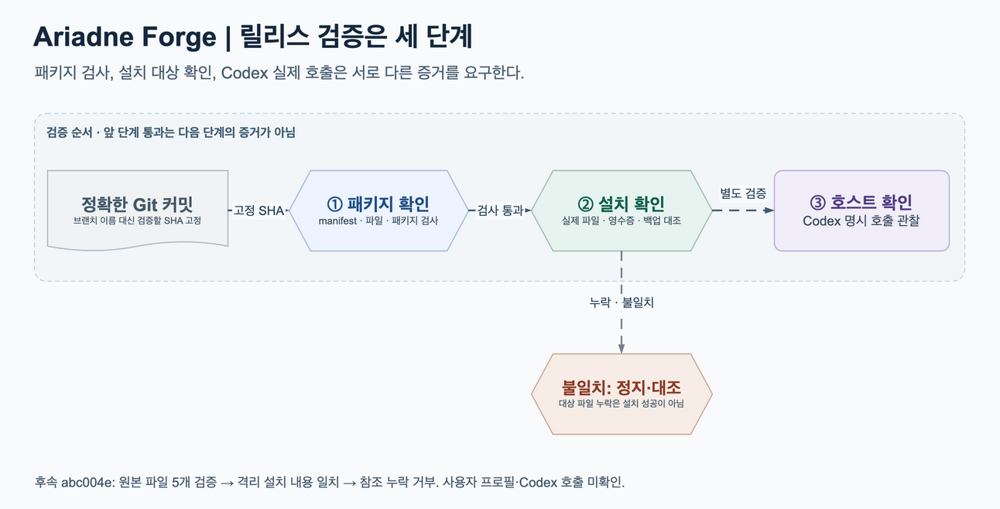

# Ariadne Forge · 포터블 릴리스 검증

[README로](../../../README.md)

| 기준 | 확인한 범위 |
| --- | --- |
| 공개 버전 `185fc97` | 저장소 로컬 Codex 스킬과 평가 기록. 이 버전이 후속 전역 패키지를 공개한다는 뜻은 아닙니다. |
| 과거 로컬 패키지 `f7c9b7c` | 당시 설치 기록이 있었지만, 이전 읽기 전용 재검사에서는 대상 스킬이 없어 재검증하지 못했습니다. |
| 로컬 후속 작업본 `abc004e` | 정확한 Git 객체에서 실제 릴리스 CLI와 실제 패키지를 불러와 새 임시 프로필에 설치했습니다. 확인용 Git 원본·설치·설치 후 검사 세 단계가 같은 내용 해시를 반환했습니다. |

시연은 원본 파일 5개 검증 → 별도 프로필에 설치 → 설치 확인 → 참조 파일 `system-coherence-gates.md` 제거 → 재검사 실패(종료 코드 1) 순서입니다. 제거는 폐기 가능한 설치 대상에만 수행했습니다. 최종 실패는 “설치한 적 있다”는 영수증보다 실제 설치 내용이 우선함을 보여줍니다.

배포 도구 검증, 현재 설치 검증, Codex 호스트에서 일어난 명시 호출은 서로 다른 증거입니다. 실제 사용자 프로필과 원본 저장소는 그대로 뒀으며, 후속 작업본의 Codex 호출은 녹화하거나 확인하지 않았습니다. 공개 저장소의 네이티브 작업 시연을 대신하는 영상이 아닙니다.

[편집용 draw.io](../assets/release.drawio) · [SVG](../assets/release.svg) · [명령 출력](release-transcript.txt)
