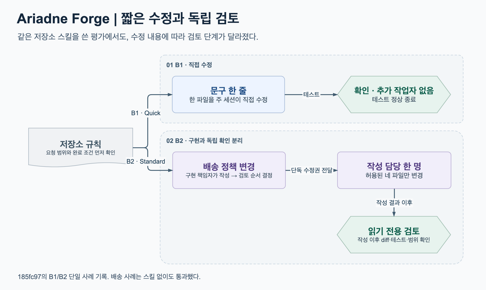

# Ariadne Forge · 작업 깊이와 실행 증거

[README로](../../../README.md)

## 작은 변경과 분리 검토를 구분한 평가

- **B1 Quick:** 인사말 파일 한 개를 수정한 뒤 테스트 종료 코드 0을 확인했습니다. 추가 에이전트는 열지 않았습니다.
- **B2 Standard:** 배송료 평가의 구현 책임자가 단일 변경 담당과 읽기 전용 검증자를 순서대로 열었습니다. 변경 담당 결과를 채택하기 전에 검증을 열지 않았습니다. 검증 전후 변경분 해시가 같았고 테스트·변경 범위·산출물을 확인했습니다.
- **기준선도 통과했습니다.** B2에서는 스킬을 쓰지 않은 조건도 같은 평가를 통과했습니다. 역할 분리를 하면 절차 비용이 늘 수 있고, 이 사례만으로 우위를 말할 수 없습니다.

[스킬 사용 평가 기록](https://github.com/SungKong00/ariadne-forge/blob/185fc97c4400d0158090f5d182a6b0e3f5d1ac2a/evals/ariadne-workflow/runs/with-skill-001/report.md) · [비교 기준선](https://github.com/SungKong00/ariadne-forge/blob/185fc97c4400d0158090f5d182a6b0e3f5d1ac2a/evals/ariadne-workflow/runs/baseline-001/report.md) · [편집용 draw.io](../assets/routing.drawio)

## 어디서 멈추나

역할을 나눠야 하는 작업에서 Codex의 네이티브 제어 수단이 없으면, 다른 셸 프로세스를 관리 주체로 바꿔치기하지 않습니다. 조사 결과가 구현을 바꿀 수 있을 때는 먼저 연구 책임자가 원문을 보고 판단합니다. 완료 보고가 실제 테스트나 변경분과 어긋나면 근거를 우선하고 완료를 보류합니다.

이 문서는 공개 평가 기록의 두 사례와 실험을 설명합니다. 이번에 실제 Codex에서 두 사례를 다시 실행하지 않았고, 운영 애플리케이션에 대한 반복 결과나 토큰 절감량을 검증하지 않았습니다.
